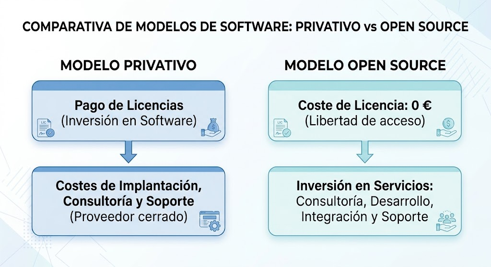
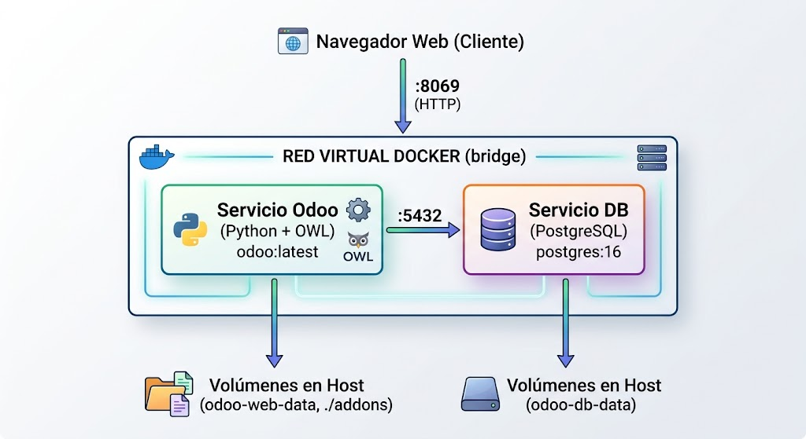
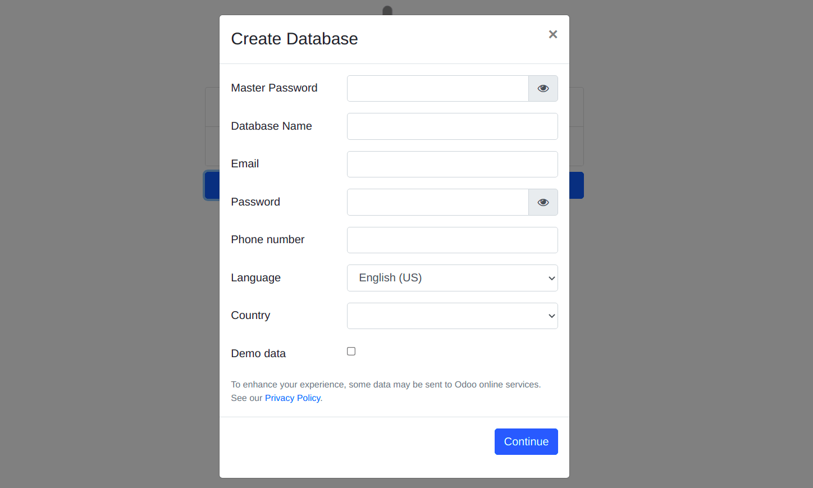

```
-------------------- SISTEMAS DE GESTIÓN EMPRESARIAL - DMOL ---------------------
---------------------------------------------------------------------------------

Módulo:                     SISTEMAS DE GESTIÓN EMPRESARIAL
Profesor:                   Víctor J. González
Unidad de Trabajo:          UT02. Instalación y configuración de sistemas ERP-CRM
Resultados de aprendizaje:  RA2.
```

# UT02: INSTALACIÓN Y CONFIGURACIÓN DE SISTEMAS ERP-CRM

## 1. Introducción

El desarrollo informático corporativo ha evolucionado significativamente en las últimas décadas. Tradicionalmente, las organizaciones cubrían sus necesidades operativas mediante **aplicaciones a medida**. Aunque este enfoque garantizaba un ajuste exacto a los flujos de trabajo iniciales, a medio y largo plazo presentaba graves inconvenientes: costes de mantenimiento desorbitados, deuda técnica acumulada, silos de información departamentales y una enorme dependencia de los programadores originales.

Frente a la dispersión de programas aislados (islas de información), se consolidaron los **Sistemas de Planificación de Recursos Empresariales (ERP)** y de **Gestión de Relaciones con Clientes (CRM)**. Desde el punto de vista del desarrollo de software, un ERP no es un único programa cerrado, sino una **plataforma modular y parametrizable** construida sobre una base de datos unificada que actúa como *única fuente de verdad*.

Un ERP moderno se fundamenta en tres pilares técnicos:

- **Integración:** cada transacción desencadena de forma atómica y transparente las operaciones asociadas en las demás áreas funcionales (por ejemplo, la confirmación de un pedido de venta genera automáticamente la reserva de stock en almacén, la orden de picking y el borrador de la factura contable, sin duplicar registros).
- **Modularidad:** el sistema se organiza en paquetes funcionales independientes (módulos o *addons*) desacoplados entre sí mediante interfaces bien definidas.
- **Adaptabilidad y extensibilidad:** permite ajustar comportamientos mediante parametrización directa o extendiendo el modelo de datos y la lógica de negocio a través de código (herencia de clases, modelos y vistas), sin alterar el código fuente del núcleo (*core*).

Para un desarrollador de software, el valor profesional no radica en reprogramar desde cero funcionalidades estándar (como una pasarela SEPA o un motor contable), sino en dominar la **arquitectura del ERP**, ser capaz de **desplegarlo, mantenerlo, integrarlo con otros sistemas (APIs REST/webhooks)** y **desarrollar módulos a medida** que implementen la lógica diferencial del cliente.


## 1.1. Tipos de licencia

Una **licencia de software** es el contrato legal entre el titular de los derechos de autor (*copyright*) y el usuario final o empresa que regula las libertades, restricciones y condiciones de uso, copia, modificación y distribución del código.

En el sector empresarial, las licencias determinan directamente los costes del proyecto, la soberanía tecnológica sobre los datos y la libertad de intervención técnica por parte del equipo de desarrollo. Se clasifican en dos grandes familias, junto con modelos híbridos contemporáneos:

- **Software privativo o propietario**. El código fuente no está disponible para su inspección ni modificación libre. La empresa adquiere un derecho de uso limitado bajo estrictas cláusulas. Se caracteriza por modelos de pago recurrente por licencias (por usuario activo, núcleos de procesador o volumen de transacciones), dependencia tecnológica del fabricante (*vendor lock-in*) y soporte técnico centralizado. Algunos ejemplos de estas soluciones son *SAP S/4HANA*, *Microsoft Dynamics 365 Business Central*, *Oracle NetSuite*.

- **Software libre y de código abierto**. Otorga a los usuarios las cuatro libertades esenciales definidas por la *Free Software Foundation* (usar, estudiar, distribuir y mejorar el software). Según los requisitos de redistribución, se dividen en:
  1. **Licencias permisivas (BSD, MIT, Apache 2.0):** otorgan máxima libertad. Permiten modificar el código, redistribuirlo e incluso incorporarlo a desarrollos privativos y comerciales sin obligación de publicar el código modificado. La única exigencia suele ser conservar los avisos originales de copyright y la exención de responsabilidad.
  2. **Licencias con Copyleft robusto (GNU GPLv3, AGPLv3):** exigen que cualquier trabajo derivado mantenga la misma licencia libre si se redistribuye (efecto recíproco o viral). En este grupo podemos incluir la licencia **AGPL (Affero GPL):**, muy relevante en aplicaciones web y ERPs, ya que cierra el vacío legal del software ofrecido como servicio (SaaS). Si el software se ejecuta en un servidor remoto accesible por red, el proveedor está obligado a ofrecer el código fuente completo a los usuarios que interactúan con él.
  3. **Licencias con Copyleft débil o limitado (GNU LGPLv3):** es la licencia utilizada por el núcleo de sistemas como **Odoo Community**. Permite que el núcleo se enlace con otros programas o módulos independientes sin obligar a que dichos módulos externos adopten la licencia LGPL, facilitando la creación de extensiones comerciales o propietarias sin perder la libertad del software base.

- **Modelo de negocio híbrido: *Open Core* y doble licenciamiento**. Es el modelo predominante en el sector ERP actual, en él encontramos:
  - **Núcleo abierto (*Community*):** gratuito y de código abierto (habitualmente bajo LGPL o AGPL), con las funciones estructurales y operativas estándar (Ventas, Compras, Facturación, Inventario básico).
  - **Capa propietaria (*Enterprise*):** una suite de módulos avanzados (contabilidad completa, automatizaciones complejas, conectores IoT, firma digital o soporte móvil nativo) sujeta a una licencia de pago por suscripción.

En la siguiente tabla puedes ver un resumen de los diversos modos de licenciamiento:

| **Modelo de licencia**         | **Acceso al código fuente** | **Coste de licencia**               | **Obligación de liberar cambios**               | **Ejemplos**                |
| ------------------------------ | --------------------------- | ----------------------------------- | ----------------------------------------------- | --------------------------- |
| **Privativo**                  | No                          | Sí (recurrente/perpetua)            | No aplica                                       | SAP, Microsoft Dynamics 365 |
| **Copyleft fuerte (GPL/AGPL)** | Sí                          | Gratuito                            | Sí (siempre que se distribuya o ejecute en red) | ERPNext, Tryton             |
| **Copyleft débil (LGPL)**      | Sí                          | Gratuito                            | Sí en el core; No en módulos independientes     | Odoo (Community Edition)    |
| **Open Core**                  | Mixto (Core sí / Extras no) | Gratuito (Core) + Pago (Enterprise) | Parcial, según el módulo modificado             | Odoo, Metasfresh            |


## 1.2. El software libre en el mercado de los ERPs

La llegada del software de código abierto transformó radicalmente el modelo económico tradicional de los ERPs corporativos.




En las soluciones abiertas o *Open Core*, el valor económico se traslada **del producto al servicio**. Las empresas consultoras e implantadoras monetizan su actividad mediante:

1. **Consultoría de procesos:** análisis y reingeniería de los circuitos de trabajo del cliente para adaptarlos a las mejores prácticas del ERP.
2. **Desarrollo a medida:** creación de nuevos modelos de datos, flujos de trabajo, informes y conexiones con terceros (e-commerce, pasarelas logísticas, sistemas MES de fábrica).
3. **Migración e integración de datos:** extracción, transformación y carga (ETL) de los datos del sistema heredado hacia la base de datos del ERP.
4. **Soporte y acuerdos de nivel de servicio:** garantía de respuesta ante caídas del sistema, resolución de incidencias y mantenimiento evolutivo.
5. **Alojamiento y DevOps:** despliegue en la nube mediante contenedores, monitorización, políticas de copias de seguridad y securización perimetral.

Este modelo conlleva una serie de ventajas para las **empresas**:

- **Eliminación o reducción drástica del canon de licencias inicial.**
- **Independencia de proveedor (*No Vendor Lock-in*):** al estar el código en lenguajes estándar (Python, PHP, SQL), la empresa puede cambiar de proveedor de servicios tecnológicos si la relación no es satisfactoria sin perder su software ni sus adaptaciones.
- **Control y auditoría del código:** garantía de privacidad y ausencia de puertas traseras (*backdoors*).

Aunque como contrapartida, también tiene una serie de **retos técnicos**:

- **Mayor responsabilidad técnica:** la organización o su consultora deben asumir la política de actualizaciones de seguridad y el mantenimiento de las personalizaciones.
- **Coste de migración entre versiones mayores:** en los ERPs de código abierto, el salto entre versiones estructurales (por ejemplo, saltar varias versiones de Odoo) requiere adaptar los módulos personalizados al nuevo ORM o arquitectura.


## 1.3. Ecosistema de ERPs de software libre y código abierto

Desde la perspectiva técnica de un desarrollador, la elección de un ERP open source viene determinada por su **stack tecnológico**, su **modelo de datos** y la solidez de su **API**. Las principales alternativas del mercado actual son:


### 1. Odoo (antes TinyERP y OpenERP)

Es la solución de referencia y el líder de mercado indiscutible en el ecosistema abierto y *open core*. Desde el punto de vista tecnológico, usa Python, PostgreSQL como base de datos y cuenta con su propio framework en JavaScript denominado OWL (Odoo Web Library) y plantillas XML (QWeb).

Su arquitectura es totalmente modular, empleando un **ORM** (*Object-Relational Mapping*) propio altamente expresivo que mapea clases de Python directamente a tablas de PostgreSQL, administrando relaciones (`Many2one`, `One2many`, `Many2many`) mediante decoradores y herencia.

Cuenta con dos versiones:

- *Odoo Community Edition:* gratuita, bajo licencia **GNU LGPLv3**.
- *Odoo Enterprise:* suscripción comercial con módulos adicionales avanzados y opción de hosting gestionado (*Odoo.sh*).


### 2. ERPNext

La alternativa 100% de código abierto más completa frente a las soluciones comerciales. En este caso también tiene un framework (Frappe Framework) basado en Python, MariaDB o PostgreSQL como base de datos y un frontend en JavaScript, Node.js y Vue.js. Su licencia es GNU GPLv3 integral (sin módulos privativos en su versión base).

Tiene una arquitectura orientada a metadatos que permite definir entidades de datos (*DocTypes*) desde la interfaz de usuario o mediante código, generando automáticamente la API REST para su consumo y las vistas CRUD correspondientes.

Su público objetivo son empresas que buscan una suite completa (fabricación, proyectos, ventas, recursos humanos, compras) bajo un esquema puramente libre y sin costes ocultos.


### 3. Dolibarr ERP/CRM

Solución clásica, compacta y muy sencilla de desplegar, especialmente popular en pequeñas empresas y autónomos. Se basa en PHP, MySQL/MariaDB o PostgreSQL como base de datos y su arquitectura se sustenta en un entorno LAMP/WAMP tradicional.

Tiene una licencia GNU GPLv3 y destaca por su consumo mínimo de recursos computacionales, sin dependencias complejas en el servidor; puede funcionar en prácticamente cualquier hosting compartido básico. Su desarrollo de módulos es directo para programadores que dominan PHP clásico.


### 4. Tryton

Proyecto nacido originalmente como un *fork* de una versión temprana de TinyERP, impulsado por desarrolladores que buscaban una arquitectura mucho más estricta y purista.

Tiene licencia GNU GPLv3 y se utiliza Python y PostgreSQL.

Es un proyecto muy enfocado en la estabilidad del código, modularidad pura y una separación limpia en tres capas reales (servidor, base de datos y clientes). Carece del volumen de comunidad de Odoo, pero destaca en entornos que priorizan robustez contable y solvencia de ingeniería sobre interfaces atractivas.


## 2. Instalación y configuración de Odoo mediante Docker Compose

El despliegue de un ERP corporativo requiere coordinar el motor de aplicaciones, sus dependencias de sistema y el gestor de bases de datos. La utilización de **contenedores Docker** y la herramienta de orquestación **Docker Compose** sustituye a las instalaciones manuales sobre el sistema operativo base, garantizando aislamiento de librerías, portabilidad idéntica entre entornos de desarrollo y producción, y una gestión limpia de los datos y dependencias técnicas.


### 2.1. Arquitectura del despliegue en contenedores

En un entorno contenerizado, la arquitectura de Odoo se desacopla en dos servicios independientes conectados a través de una red virtual compartida:



1. **Servicio de aplicación (`web`):** contenedor basado en la imagen oficial de Odoo que incluye el runtime de Python, el servidor web interno, las dependencias nativas (como `wkhtmltopdf` para reportes PDF) y los módulos base.
2. **Servicio de base de datos (`db`):** contenedor con la imagen oficial de **PostgreSQL**, aislado del exterior y accesible únicamente por el contenedor de Odoo a través de la resolución DNS interna de Docker.
3. **Persistencia (Volúmenes):** tanto la información de la base de datos como los ficheros subidos por los usuarios (*filestore*) deben residir en volúmenes persistentes administrados por Docker para evitar la pérdida de datos tras reiniciar o destruir los contenedores.
4. **Desarrollo de módulos propios (Bind Mounts):** un directorio local en la máquina anfitriona (`./addons`) se mapea directamente al interior del contenedor, permitiendo editar código en el IDE local y ver los resultados reflejados en Odoo sin reconstruir la imagen.


### 2.2. Estructura del proyecto y fichero `docker-compose.yml`

Para organizar el despliegue y preparar el entorno para la programación de módulos, debes establecer la siguiente estructura de carpetas en el equipo de trabajo:

```text
odoo-dev/
├── config/
│   └── odoo.conf          # Archivo de configuración avanzado
├── addons/                # Carpeta para módulos personalizados (desarrollo DAM)
└── docker-compose.yml     # Definición de servicios, volúmenes y redes
```

El archivo `docker-compose.yml` define los dos contenedores, sus variables de entorno, la redirección de puertos y los puntos de montaje:

```yaml
services:
  db:
    image: postgres:16
    container_name: odoo_db
    restart: always
    environment:
      - POSTGRES_DB=postgres
      - POSTGRES_USER=odoo
      - POSTGRES_PASSWORD=odoo_secret_password
    volumes:
      - odoo-db-data:/var/lib/postgresql/data
    networks:
      - odoo-net

  web:
    image: odoo:17.0
    container_name: odoo_web
    restart: always
    depends_on:
      - db
    ports:
      - "8069:8069"
    environment:
      - HOST=db
      - USER=odoo
      - PASSWORD=odoo_secret_password
    volumes:
      - odoo-web-data:/var/lib/odoo
      - ./config:/etc/odoo
      - ./addons:/mnt/extra-addons
    networks:
      - odoo-net

volumes:
  odoo-db-data:
  odoo-web-data:

networks:
  odoo-net:
    driver: bridge
```

Algunas consideraciones respecto al fichero anterior:

- **Resolución de nombres:** la variable `HOST=db` indica a Odoo que localice el gestor de bases de datos utilizando el identificador de servicio `db` proporcionado por el servidor DNS interno de Docker.
- **Mapeo de puertos:** el parámetro `"8069:8069"` expone el puerto estándar de Odoo en la máquina anfitriona (*host*), permitiendo el acceso local vía web.
- **Separación de capas:** el puerto de PostgreSQL (`5432`) no está mapeado al host, protegiendo la base de datos contra accesos no autorizados directos desde el exterior de la máquina.


### 2.3. Parámetros del servidor: fichero `odoo.conf`

Aunque las variables del entorno del `docker-compose.yml` permiten un arranque funcional básico, en entornos de desarrollo y producción se utiliza el archivo de configuración `/etc/odoo/odoo.conf` para controlar directivas del servidor y rutas de módulos.

Contenido inicial recomendado para `config/odoo.conf`:

```ini
[options]
; Contraseña maestra para crear, duplicar, restaurar o borrar bases de datos
admin_passwd = SuperMasterKey_Secure2026

; Conexión a la base de datos
db_host = db
db_port = 5432
db_user = odoo
db_password = odoo_secret_password

; Rutas donde Odoo buscará módulos (addons base + carpeta de desarrollo)
addons_path = /usr/lib/python3/dist-packages/odoo/addons,/mnt/extra-addons

; Configuración de rendimiento y logs
logfile = /var/lib/odoo/odoo-server.log
log_level = info
```


### 2.4. Ciclo de vida y operación del servicio

El control del entorno se realiza desde la terminal situada en el directorio `odoo-dev/` mediante la interfaz de comandos de Docker Compose:

- Descarga de imágenes y puesta en marcha en segundo plano: `docker compose up -d`
- Inspección de trazas y depuración en tiempo real: `docker compose logs -f web`
- Reinicio de la capa de aplicación (requerido tras alterar código Python de un módulo): `docker compose restart web`
- Detención del entorno preservando datos: `docker compose down`
- Acceso interactivo al contenedor de Odoo (CLI/bash): `docker compose exec web /bin/bash`

Un aspecto relevante respecto a la persistencia es que el comando `docker compose down` detiene y retira los contenedores pero mantiene intactos los volúmenes (`odoo-db-data` y `odoo-web-data`). Para reiniciar la base de datos desde cero es necesario pasar el flag de borrado de volúmenes: `docker compose down -v`.


### 2.5. Inicialización y parametrización web

Una vez arrancado el servicio, se accede desde el navegador web a la dirección:

$$\text{http://localhost:8069}\quad\text{o}\quad\text{http://<IP\_Servidor>:8069}$$

Al no existir ninguna base de datos creada, Odoo redirige automáticamente a la pantalla del **Database Manager** (`/web/database/selector`).




#### Parámetros clave en la inicialización:

1. **Master Password:** debe coincidir con la directiva `admin_passwd` definida en `odoo.conf`.
2. **Database Name:** nombre técnico que adoptará la base de datos física en PostgreSQL. Solo permite minúsculas, números y guiones bajos (por ejemplo, `gestion_dam_2026`).
3. **Email / Password:** credenciales de acceso del usuario administrador inicial (`id=1` / `res.users`).
4. **Country (Localización):** al seleccionar **Spain**, el sistema carga automáticamente la estructura impositiva estatal (tipos de IVA estándar, reducido, superreducido y recargo de equivalencia) y prepara la base de datos para la instalación del **Plan General Contable Español**.
5. **Demo data (Datos de prueba):**
   - En *entornos de formación y pruebas* se recomienda marcar la casilla para disponer de un ecosistema funcional con clientes ficticios, productos, facturas previas y movimientos de stock para realizar simulaciones.
   - En *entornos de producción* debe dejarse **desmarcada**, ya que los datos de demostración se mezclan de forma irreversible con el histórico contable y operativo del ERP.


## 3. Tipos de módulos y características funcionales

En un ERP moderno como Odoo, toda la funcionalidad se articula mediante **módulos** (*addons*). Técnicamente, un módulo es un paquete de software que amplía o modifica el sistema mediante cuatro capas:

- **Modelo de datos:** clases en Python que definen tablas y lógica de negocio mediante el ORM.
- **Vistas e interfaz:** ficheros XML que definen formularios, listas, kanbans y menús.
- **Seguridad y permisos:** reglas de acceso a nivel de modelo (*Access Rights* en ficheros CSV) y de registro (*Record Rules* en XML).
- **Controladores e informes:** endpoints web/API y plantillas de impresión (QWeb/PDF).

El valor clave del ERP es la **interconexión**: ningún módulo opera de forma aislada; los datos fluyen de uno a otro compartiendo registros relacionales sin duplicar información.


### 3.1. El Módulo Base (`base`)

Es el núcleo indispensable del ERP. No implementa procesos comerciales por sí mismo, sino que provee el framework sobre el que operan todos los demás módulos:

- **Entidades transversales:** define las tablas maestras compartidas por todo el sistema, como contactos (`res.partner`), usuarios (`res.users`) y empresas (`res.company`).
- **Seguridad y control de acceso:** administra la autenticación, grupos de permisos y roles de usuario.
- **Gestor de aplicaciones:** permite buscar, instalar, actualizar y desinstalar el resto de módulos del catálogo.
- **Parámetros del sistema e internacionalización:** configuración de idiomas, monedas y formatos numéricos y de fecha.


### 3.2. Módulos de Operaciones: Compras, Ventas e Inventario

Gestionan el ciclo operativo de aprovisionamiento, almacenamiento y comercialización:

- **Ventas (`sale`):**
      -  Gestión de presupuestos, pedidos en firme y tarifas de precios.
      -  Al confirmarse un pedido de venta, desencadena automáticamente la reserva de stock y el requerimiento de facturación.
- **Compras (`purchase`):**
      - Control de solicitudes de presupuesto (RFQ) a proveedores y órdenes de compra oficiales.
      - Recepción de mercancía integrada directamente con almacén y validación de facturas de proveedor contra los albaranes de entrada.
- **Inventario / Almacén (`stock`):**
      - Utiliza un sistema de **inventario de doble entrada** (las mercancías no se crean ni se destruyen, se mueven entre ubicaciones virtuales y físicas).
      - Control multialmacén, rutas de abastecimiento (dropshipping, cross-docking) y trazabilidad completa por lotes y números de serie.


### 3.3. Módulos Financieros: Facturación, Contabilidad y Localización

- **Facturación (`account`):**
      - Registro de facturas de clientes y facturas de proveedores (`account.move`).
      - Estados del documento: *Borrador* (editable), *Publicada* (inmutable con asignación de número correlativo) y *Pagada*.
      - Gestión de cobros, pagos, remesas bancarias (SEPA) y conciliación automática.
- **Contabilidad y Localización Española (`l10n_es`):**
      - Adapta el ERP a la normativa legal, fiscal y mercantil de España.
      - **Plan General Contable (PGC 2008 / PYMEs):** Estructura jerárquica de cuentas contables.
      - **Motor impositivo:** Configuración de tipos impositivos (IVA general, reducido, superreducido, recargo de equivalencia y retenciones de IRPF).
      - Validación legal de documentos de identidad (NIF, CIF, NIE) y soporte para libros oficiales y plataformas de facturación electrónica.


### 3.4. Relaciones con Clientes (CRM) y Gestión de Personas (RRHH)

- **CRM (`crm`):**
      - Orientado a la captación y fidelización comercial antes de que exista una venta formal.
      - **Pipeline comercial:** Visualización en tablero Kanban de iniciativas (*leads*) y oportunidades a lo largo de fases configurables (*Nuevo $\rightarrow$ Calificado $\rightarrow$ Propuesta $\rightarrow$ Ganado*).
      - Registro de interacciones (correos, llamadas, reuniones) y estimación ponderada de ingresos previstos.
- **Recursos Humanos (`hr`):**
      - Gestión de la estructura organizativa: empleados, departamentos y jerarquías.
      - Módulos complementarios para control horario/fichajes (`hr_attendance`), solicitud y aprobación de ausencias y vacaciones (`hr_holidays`), y gestión de gastos del personal (`hr_expense`).


## 4.- Asistencia técnica remota

Poco relevante

## 5.- Herramientas para la programación de sistemas ERP-CRM

Subiré material complementario para explicar el entorno de desarrollo que utilizaremos este curso