```
-------------------- SISTEMAS DE GESTIÓN EMPRESARIAL - DMOL ---------------------
---------------------------------------------------------------------------------

Módulo:                     SISTEMAS DE GESTIÓN EMPRESARIAL
Profesor:                   Víctor J. González
Unidad de Trabajo:          UT03. Organización, consulta y tratamiento de la información
Resultados de aprendizaje:  RA3
```

# UT03: ORGANIZACIÓN, CONSULTA Y TRATAMIENTO DE LA INFORMACIÓN

# 1. Organización y consulta de la información en el ERP

## 1.1. Arquitectura de datos del ERP: El ORM frente al modelo relacional

En el desarrollo de software corporativo contemporáneo, un ERP no interactúa con el motor de base de datos ejecutando sentencias SQL tradicionales escritas a mano. En su lugar, implementa un **ORM** (*Object-Relational Mapping* o Mapeo Objeto-Relacional).

El ORM actúa como una capa de abstracción bidireccional que traduce las clases y objetos definidos en el código fuente (Python en el caso de Odoo) en entidades, tablas y relaciones dentro del Sistema Gestor de Bases de Datos Relacionales (PostgreSQL).

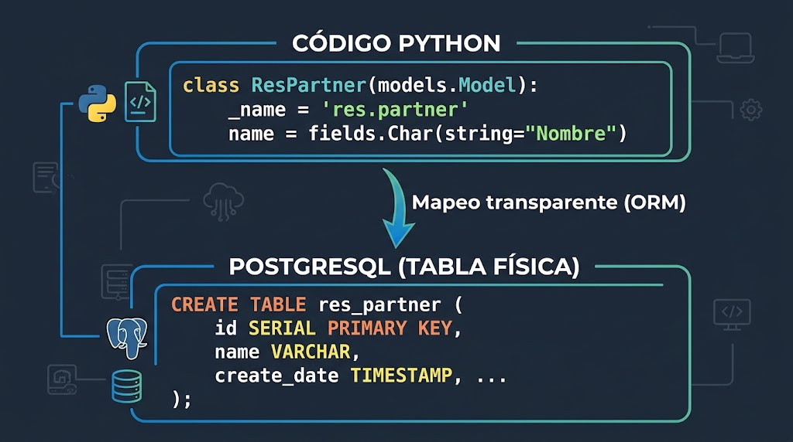

```
┌────────────────────────────────────────────────────────┐
│                   CÓDIGO PYTHON                        │
│   class ResPartner(models.Model):                      │
│       _name = 'res.partner'                            │
│       name = fields.Char(string="Nombre")              │
└───────────────────────────┬────────────────────────────┘
                            │  Mapeo transparente (ORM)
                            ▼
┌────────────────────────────────────────────────────────┐
│                 POSTGRESQL (TABLA FÍSICA)              │
│   CREATE TABLE res_partner (                           │
│       id SERIAL PRIMARY KEY,                           │
│       name VARCHAR,                                    │
│       create_date TIMESTAMP, ...                       │
│   );                                                   │
└────────────────────────────────────────────────────────┘

```

### Reglas de persistencia y convención de nombres

1. **Identificadores de tabla:** por convención técnica, el atributo `_name` de un modelo Python sustituye los puntos por guiones bajos al materializarse en la base de datos. Por ejemplo:
   - El modelo `res.partner` se almacena físicamente en la tabla `res_partner`.
   - El modelo `sale.order` se almacena físicamente en la tabla `sale_order`.
   - El modelo `account.move` se almacena físicamente en la tabla `account_move`.
2. **Clave primaria implícita (`id`):** todo modelo administrado por el ORM genera automáticamente una columna de clave primaria entera, autonumérica y única denominada `id`. Los desarrolladores nunca declaran este campo manualmente en el código.
3. **Campos del sistema y auditoría obligatoria:** en cada inserción o modificación, el ORM inyecta y mantiene automáticamente cuatro campos técnicos para auditoría interna:
- `create_uid`: Clave foránea al usuario (`res_users`) que insertó el registro.
- `create_date`: Marca temporal UTC de inserción.
- `write_uid`: Clave foránea al último usuario que modificó el registro.
- `write_date`: Marca temporal UTC de la última modificación.


### Mapeo de tipos y relaciones de datos

El ORM traduce los tipos de datos de alto nivel a tipos nativos del gestor relacional:

| Tipo en ORM (Python)              | Tipo físico en PostgreSQL      | Comportamiento relacional / Almacenamiento                                                                    |
| --------------------------------- | ------------------------------ | ------------------------------------------------------------------------------------------------------------- |
| `fields.Char`                     | `VARCHAR`                      | Cadenas cortas de texto indexables (monolínea).                                                               |
| `fields.Text`                     | `TEXT`                         | Bloques extensos de texto multilinea.                                                                         |
| `fields.Integer`                  | `INTEGER` / `INT4`             | Valores numéricos enteros.                                                                                    |
| `fields.Float`                    | `NUMERIC` o `FLOAT8`           | Valores decimales con precisión configurable.                                                                 |
| `fields.Boolean`                  | `BOOLEAN`                      | Valores lógicos (`true`/`false`).                                                                             |
| `fields.Date` / `fields.Datetime` | `DATE` / `TIMESTAMP`           | Fechas y marcas de tiempo UTC.                                                                                |
| `fields.Many2one`                 | `INTEGER REFERENCES tabla(id)` | Crea una columna física de clave foránea con sufijo `_id` e integridad referencial .                          |
| `fields.One2many`                 | *Ninguno (Virtual)*            | No genera columnas en la tabla física de origen; consulta las claves foráneas existentes en la tabla destino. |
| `fields.Many2many`                | `TABLA INTERMEDIA`             | Genera una tabla de unión física con dos columnas de claves foráneas para resolver relaciones $N:M$.          |

### Modelos maestros transversales

El diseño de la base de datos se articula alrededor de modelos centrales compartidos por todos los módulos funcionales del ERP:

- **`res.partner` (Contactos y Entidades):** modela tanto a personas físicas como jurídicas. Un único modelo gestiona clientes, proveedores, transportistas, contactos de facturación y direcciones de entrega mediante una estructura jerárquica padre-hijo (`parent_id`) y discriminadores como `is_company` o `type` (`contact`, `invoice`, `delivery`).
- **`res.users` (Usuarios del Sistema):** registra las credenciales de acceso, configuraciones de idioma y derechos de seguridad. Cada registro de `res.users` tiene una relación 1:1 estricta con una ficha asociada en `res.partner`.
- **`res.company` (Empresas):** define las unidades de negocio en entornos multicompañía, asociando planes contables, monedas principales y domicilios fiscales específicos.
- **`account.move` (Asientos y Facturas):** tabla central del módulo financiero donde se registran tanto facturas de clientes, facturas de proveedores como apuntes contables manuales.

### Inspección técnica de modelos desde la interfaz

Para analizar cómo están construidos los modelos sin recurrir a la consola, el ERP ofrece el **Modo Desarrollador** (*Developer Mode*):

1. **Activación:** se habilita añadiendo `?debug=1` en la URL del navegador o desde *Ajustes -> Herramientas de desarrollador -> Activar modo desarrollador*.
2. **Ruta de acceso:** *Ajustes -> Técnico -> Estructura de la base de datos -> Modelos* (`ir.model`).
3. **Información disponible:** permite consultar los nombres técnicos de los campos, su tipo de dato, las restricciones SQL activadas, los permisos de acceso asignados por grupo y las vistas en las que interviene cada campo.


## 1.2. Consulta e inspección de datos: Herramientas gráficas vs. ORM

A la hora de examinar el estado de los datos del ERP, existen dos vías con propósitos y restricciones claramente diferenciados: la inspección mediante clientes SQL externos y la interacción programática a través del propio ORM.

### A) Inspección externa mediante clientes SQL (DBeaver / pgAdmin)

En un despliegue contenerizado con Docker Compose, el contenedor de base de datos PostgreSQL almacena la totalidad del esquema físico. Herramientas de administración gráfica como **DBeaver** o **pgAdmin 4** se conectan directamente al puerto de PostgreSQL (puerto `5432`):

- **Uso exclusivo en desarrollo y auditoría:** Esta conexión se debe limitar a la **lectura y análisis**. Es útil para evaluar planes de ejecución de consultas pesadas (`EXPLAIN ANALYZE`), auditar el crecimiento de tablas de logs o diseñar consultas analíticas para herramientas externas de Business Intelligence.

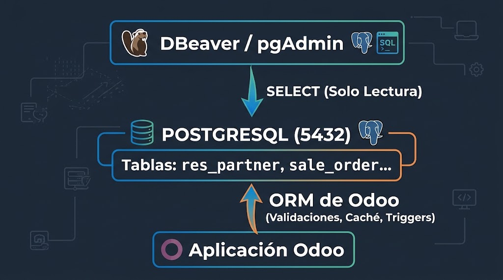


```
                  ┌──────────────────────────────────────────────┐
                  │                 DBeaver / pgAdmin            │
                  └──────────────────────┬───────────────────────┘
                                         │  SELECT (Solo Lectura)
                                         ▼
  ┌────────────────────────────────────────────────────────────────────────┐
  │                           POSTGRESQL (5432)                            │
  │                     Tablas: res_partner, sale_order...                 │
  └──────────────────────────────────────▲─────────────────────────────────┘
                                         │
                                   ORM de Odoo
                          (Validaciones, Caché, Triggers)
                                         │
                  ┌──────────────────────┴───────────────────────┐
                  │               Aplicación Odoo                │
                  └──────────────────────────────────────────────┘

```

### Por qué está terminantemente prohibido alterar la base de datos por SQL directo

Ejecutar sentencias de modificación (`INSERT`, `UPDATE`, `DELETE`) directamente sobre la base de datos sin pasar por el ORM compromete la estabilidad del ERP debido a cinco factores críticos:

1. **Destrucción de la memoria caché:** el ORM almacena en memoria RAM una caché multinivel de registros y campos. Una modificación directa vía SQL altera los datos en disco, pero el ERP seguirá sirviendo los valores en caché desactualizados, produciendo inconsistencias lógicas.
2. **Omisión de validaciones de negocio:** las reglas de integridad complejas se definen en Python mediante decoradores como `@api.constrains`. Una sentencia SQL omite estas restricciones, permitiendo, por ejemplo, que una factura confirmada vuelva a un estado inconsistente o que un balance descuadre.
3. **Rotura de campos computados (`@api.depends`):** al modificar un valor mediante SQL (por ejemplo, el precio unitario de una línea de pedido), los campos dependientes calculados (subtotal, base imponible, impuestos totales del pedido) **no se recalculan**.
4. **Desactivación de la auditoría y mensajería:** el ERP no actualizará los campos de auditoría (`write_date`, `write_uid`) ni registrará las notas de cambio en el hilo de seguimiento (*chatter* o tabla `mail.message`).
5. **Vulneración de las reglas de seguridad (*Record Rules*):** las restricciones que impiden que un comercial vea clientes de otra delegación o compañía se evalúan dinámicamente en Python; una consulta SQL plana no respeta ninguna de estas políticas de aislamiento.

---

### B) Consulta e interacción programática mediante el ORM

La vía segura y profesional para consultar o manipular datos fuera de la interfaz web es la consola interactiva del ERP, conocida como **Odoo Shell**. Esta herramienta carga el entorno de ejecución, inicializa la conexión con PostgreSQL y expone la API completa del ORM.

Para abrir la consola dentro del contenedor en ejecución:

```bash
docker compose exec web odoo shell -d nombre_de_tu_bd
```

Una vez dentro de la terminal de Python, la variable `self.env` da acceso a todos los modelos del sistema mediante la sintaxis de diccionario `env['nombre.del.modelo']`:

#### 1. Búsqueda con dominios: método `search()`

El método `search()` recibe como parámetro una lista de tuplas con el formato `(campo, operador, valor)` y devuelve un conjunto de registros (*recordset*):

```python
# Obtener todos los partners que sean empresas radicadas en España
partners_es = env['res.partner'].search([
    ('is_company', '=', True),
    ('country_id.code', '=', 'ES')
])

print(f"Total encontrados: {len(partners_es)}")
for p in partners_es:
    print(f"ID: {p.id} - Nombre: {p.name}")

```

Operadores habituales en dominios de búsqueda:

- Comparación estándar: `=`, `!=`, `>`, `>=`, `<`, `<=`
- Pertenencia: `in`, `not in` (compara contra listas de valores o IDs)
- Coincidencia de cadenas: `like`, `ilike` (esta última sin distinción entre mayúsculas y minúsculas)
- Operadores lógicos de dominio: Por defecto, los criterios dentro de la lista se evalúan con un operador **AND** implícito. Para evaluar un **OR**, se prefija con el operador `'|'`:
```python
# Clientes cuyo nombre contenga 'Tech' O cuyo país sea España
clientes = env['res.partner'].search([
    '|', 
    ('name', 'ilike', 'Tech'), 
    ('country_id.code', '=', 'ES')
])

```


#### 2. Carga por identificador: método `browse()`

Cuando se conoce el identificador numérico de clave primaria (`id`), `browse()` recupera directamente el *recordset* sin necesidad de evaluar filtros de búsqueda:

```python
# Cargar el registro de res.partner cuyo id sea 1
admin_partner = env['res.partner'].browse(1)
print(admin_partner.name, admin_partner.email)

```

#### 3. Optimización para lectura masiva: método `search_read()`

Combina una búsqueda con la extracción selectiva de campos, retornando una lista de diccionarios Python ligera y serializable (ideal para construir servicios web o APIs REST):

```python
# Extrae solo id, name y email de los primeros 5 clientes
datos_clientes = env['res.partner'].search_read(
    domain=[('customer_rank', '>', 0)],
    fields=['name', 'email'],
    limit=5
)
# Retorna: [{'id': 12, 'name': 'Acme Corp', 'email': 'info@acme.com'}, ...]

```

#### 4. Navegación relacional orientada a objetos (*Dot Notation*)

El ORM permite navegar a través de relaciones `Many2one` de forma encadenada sin necesidad de declarar sentencias `JOIN` explícitas:

```python
# Navegar desde un pedido de venta a los datos fiscales del cliente
pedido = env['sale.order'].browse(42)

# Acceso directo al país del cliente asociado al pedido
pais_cliente = pedido.partner_id.country_id.name

```


# 2. Visualización de la información: Vistas, menús y acciones

La capa de presentación en Odoo se gestiona de forma completamente declarativa mediante ficheros **XML**. A diferencia de los desarrollos convencionales donde la interfaz de usuario se acopla directamente a la lógica de negocio, el ERP implementa un patrón donde las pantallas no se programan de manera imperativa: se describen mediante etiquetas semánticas y el motor web (*web client*) se encarga de interpretarlas y renderizarlas en el navegador.


## 2.1. Arquitectura de la interfaz de usuario basada en XML

Todas las pantallas que visualiza el usuario (formularios, listados, gráficos o diálogos modales) son registros almacenados en la tabla del sistema **`ir.ui.view`**. Al instalar o actualizar un módulo, el framework lee los ficheros XML declarados en el manifiesto (`__manifest__.py`) y persiste la estructura en la base de datos.

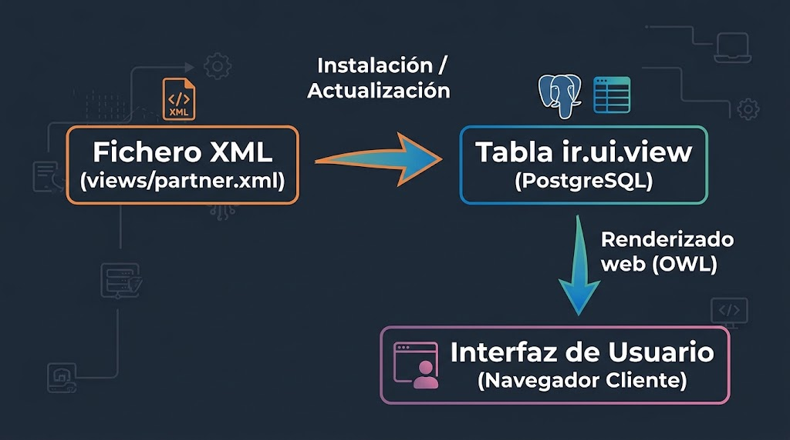

```
┌────────────────────────┐       Instalación /       ┌────────────────────────┐
│  Fichero XML           │         Actualización     │  Tabla ir.ui.view      │
│  (views/partner.xml)   │ ────────────────────────> │  (PostgreSQL)          │
└────────────────────────┘                           └───────────┬────────────┘
                                                                 │
                                                       Renderizado web (OWL)
                                                                 ▼
                                                     ┌────────────────────────┐
                                                     │  Interfaz de Usuario   │
                                                     │  (Navegador Cliente)   │
                                                     └────────────────────────┘

```

### Principio de extensión mediante herencia y XPath

En desarrollo profesional está terminantemente prohibido modificar los archivos XML estándar del sistema. Si se requiere añadir un campo o alterar el comportamiento de una vista existente, se crea una **vista heredada** que utiliza expresiones **XPath** para inyectar o modificar elementos:

```xml
<record id="view_partner_form_inherit_dam" model="ir.ui.view">
    <field name="name">res.partner.form.inherit.dam</field>
    <field name="model">res.partner</field>
    <field name="inherit_id" ref="base.view_partner_form"/>
    <field name="arch" type="xml">
        <!-- Localiza el campo 'vat' (NIF/CIF) e inserta un campo nuevo justo después -->
        <xpath expr="//field[@name='vat']" position="after">
            <field name="codigo_estudiante"/>
        </xpath>
    </field>
</record>

```

Los valores admitidos para el atributo `position` en XPath son:

* `after`: Inserta el contenido inmediatamente después del nodo encontrado.
* `before`: Inserta el contenido inmediatamente antes del nodo encontrado.
* `inside`: Añade el contenido como hijo al final del nodo contenedor.
* `replace`: Sustituye completamente el nodo seleccionado.
* `attributes`: Permite modificar propiedades del nodo (como cambiar un atributo `readonly`).

---

## 2.2. Tipos de vistas principales y diseño de formularios

Odoo clasifica las vistas según el modo de interacción con el modelo de datos:

### A) Vistas de lista o árbol (`<list>` / `<tree>`)

Presentan los registros en formato tabular (filas y columnas). Permiten ordenación por columnas, selección múltiple y edición directa sin abrir el formulario si se define el atributo `editable="bottom"` o `editable="top"`:

```xml
<record id="view_gestion_alumnos_list" model="ir.ui.view">
    <field name="name">gestion.alumnos.list</field>
    <field name="model">gestion.alumnos</field>
    <field name="arch" type="xml">
        <list string="Listado de Alumnos" decoration-danger="calificacion &lt; 5">
            <field name="dni"/>
            <field name="name"/>
            <field name="email"/>
            <field name="calificacion"/>
            <field name="state" widget="badge"/>
        </list>
    </field>
</record>

```

* **Decoradores visuales (`decoration-*`):** Aplican estilos condicionales a la fila completa según una expresión booleana (`decoration-danger`, `decoration-success`, `decoration-muted`, `decoration-info`).

---

### B) Vistas de formulario (`<form>`)

Representan un único registro en modo lectura o edición. Siguen una estructura semántica estándar que organiza la pantalla en tres zonas: cabecera (*header*), cuerpo (*sheet*) y seguimiento (*chatter*):

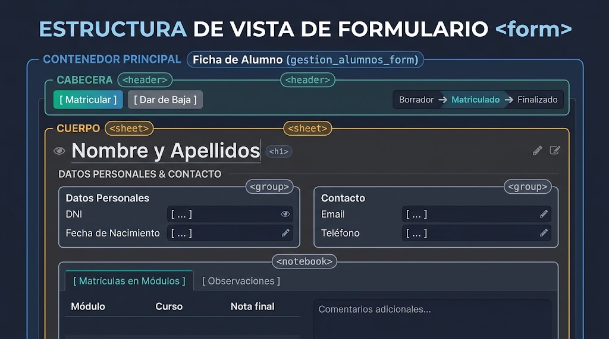

```
┌────────────────────────────────────────────────────────────────────────┐
│ <header>   [ Botón Validar ]   [ Botón Cancelar ]   (Borrador > [Hecho])│
├────────────────────────────────────────────────────────────────────────┤
│ <sheet>                                                                │
│   Título / Nombre del Registro                                         │
│   ┌──────────────────────────────┬──────────────────────────────────┐  │
│   │ <group>                      │ <group>                          │  │
│   │  Campo 1: [               ]  │  Campo 3: [                   ]  │  │
│   │  Campo 2: [               ]  │  Campo 4: [                   ]  │  │
│   └──────────────────────────────┴──────────────────────────────────┘  │
│   <notebook>                                                           │
│     [ Pestaña 1: Líneas de Detalle ] [ Pestaña 2: Notas Internas ]     │
└────────────────────────────────────────────────────────────────────────┘

```

Ejemplo de definición técnica de un formulario:

```xml
<record id="view_gestion_alumnos_form" model="ir.ui.view">
    <field name="name">gestion.alumnos.form</field>
    <field name="model">gestion.alumnos</field>
    <field name="arch" type="xml">
        <form string="Ficha de Alumno">
            <!-- Barra superior: Botones de acción y barra de estados -->
            <header>
                <button name="action_matricular" string="Matricular" type="object" 
                        class="oe_highlight" invisible="state != 'borrador'"/>
                <button name="action_baja" string="Dar de Baja" type="object" 
                        invisible="state == 'baja'"/>
                <field name="state" widget="statusbar" 
                       statusbar_visible="borrador,matriculado,finalizado"/>
            </header>
            
            <sheet>
                <div class="oe_title">
                    <h1><field name="name" placeholder="Nombre y Apellidos"/></h1>
                </div>
                
                <!-- Maquetación en dos columnas equilibradas -->
                <group>
                    <group string="Datos Personales">
                        <field name="dni"/>
                        <field name="fecha_nacimiento"/>
                    </group>
                    <group string="Contacto">
                        <field name="email" required="1"/>
                        <field name="telefono"/>
                    </group>
                </group>
                
                <!-- Pestañas para información extendida y relaciones One2many -->
                <notebook>
                    <page string="Matrículas en Módulos">
                        <field name="matricula_ids">
                            <list editable="bottom">
                                <field name="modulo_id"/>
                                <field name="curso_academico"/>
                                <field name="nota_final"/>
                            </list>
                        </field>
                    </page>
                    <page string="Observaciones">
                        <field name="notas_internas" placeholder="Comentarios adicionales..."/>
                    </page>
                </notebook>
            </sheet>
        </form>
    </field>
</record>

```

#### Atributos dinámicos en vistas

En el desarrollo actual, el control de la visibilidad y el comportamiento de los campos se define mediante **expresiones de Python directas**:

* `invisible="state == 'baja'"`: Oculta el elemento en función del valor de otros campos.
* `readonly="state != 'borrador'"`: Bloquea la edición sin necesidad de código imperativo.
* `required="tipo == 'empresa'"`: Fuerza la obligatoriedad del campo en tiempo de ejecución.

---

### C) Vistas visuales complementarias

* **Kanban (`<kanban>`):** Presenta los registros como tarjetas organizadas en columnas según un campo de estado o etapa. Ideal para flujos de trabajo (CRM, proyectos o incidencias).
* **Gráficos (`<graph>` y `<pivot>`):** Transforman el modelo en un cuadro de mando con gráficos de barras, líneas o tablas dinámicas para análisis agregado de métricas.

---

## 2.3. Jerarquía de navegación: Menús y acciones de ventana

El acceso del usuario a las vistas se articula a través del desacoplamiento entre **Menús** y **Acciones de Ventana** (`ir.actions.act_window`).

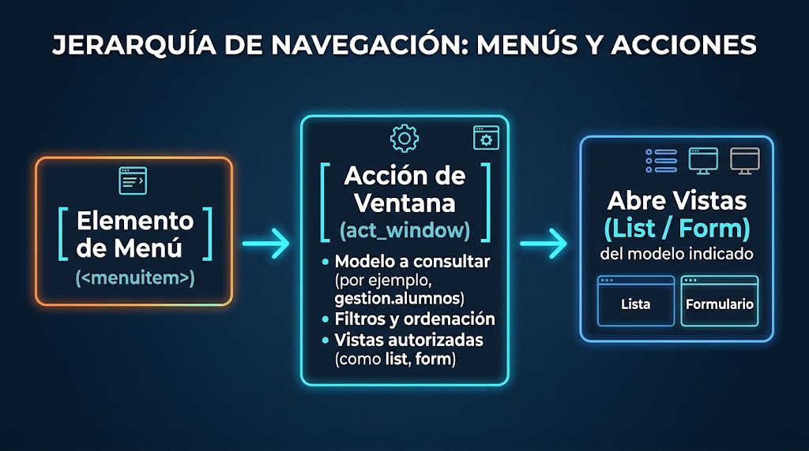

```
  [ Elemento de Menú ] ──> [ Acción de Ventana (act_window) ] ──> Abre Vistas (List / Form)
    (<menuitem>)                 - Modelo a consultar               del modelo indicado
                                 - Filtros y ordenación
                                 - Vistas autorizadas

```

### 1. Definición de la Acción de Ventana (`ir.actions.act_window`)

Indica al sistema qué modelo de datos debe consultar y qué vistas debe instanciar:

```xml
<record id="action_gestion_alumnos" model="ir.actions.act_window">
    <field name="name">Gestión de Alumnos</field>
    <field name="res_model">gestion.alumnos</field>
    <field name="view_mode">list,form,kanban</field>
    <field name="domain">[('active', '=', True)]</field>
    <field name="context">{'search_default_filtro_activos': 1}</field>
    <field name="help" type="html">
        <p class="o_view_nocontent_smiling_face">
            Haz clic en Nuevo para crear el primer registro de alumno.
        </p>
    </field>
</record>

```

* **`res_model`:** Nombre técnico del modelo Python a cargar.
* **`view_mode`:** Secuencia de vistas que se cargarán al pulsar el botón (por defecto abrirá la primera indicada en la lista).
* **`domain`:** Filtro de backend inmutable para acotar los datos mostrados.
* **`context`:** Diccionario que pasa variables al entorno o activa filtros predeterminados.

### 2. Declaración de la jerarquía de menús (`<menuitem>`)

Los menús se organizan jerárquicamente a través del atributo `parent`:

```xml
<!-- Menú Raíz (Icono en el panel principal de aplicaciones) -->
<menuitem id="menu_gestion_escolar_root" 
          name="Gestión Escolar" 
          web_icon="gestion_escolar,static/description/icon.png" 
          sequence="10"/>

<!-- Menú Intermedio (Pestaña o desplegable superior) -->
<menuitem id="menu_gestion_escolar_alumnado" 
          name="Alumnado" 
          parent="menu_gestion_escolar_root" 
          sequence="10"/>

<!-- Menú Hoja (Enlace final que invoca la acción de ventana) -->
<menuitem id="menu_gestion_alumnos_act" 
          name="Alumnos" 
          parent="menu_gestion_escolar_alumnado" 
          action="action_gestion_alumnos" 
          sequence="10"/>

```

---

## 2.4. Búsqueda y filtrado de información

La barra superior de búsqueda se configura asociando una vista de tipo `<search>` al modelo. Esta vista permite definir campos de búsqueda rápida, filtros de registros con dominios específicos y agrupaciones dinámicas:

```xml
<record id="view_gestion_alumnos_search" model="ir.ui.view">
    <field name="name">gestion.alumnos.search</field>
    <field name="model">gestion.alumnos</field>
    <field name="arch" type="xml">
        <search string="Búsqueda de Alumnos">
            <!-- Campos sobre los que el usuario puede buscar texto libre -->
            <field name="name" string="Nombre o Apellidos" 
                   filter_domain="['|', ('name', 'ilike', self), ('dni', 'ilike', self)]"/>
            <field name="email"/>

            <!-- Filtros booleanos predefinidos mediante dominios de backend -->
            <filter name="filtro_matriculados" string="Matriculados" 
                    domain="[('state', '=', 'matriculado')]"/>
            <filter name="filtro_aprobados" string="Aprobados (>= 5)" 
                    domain="[('calificacion', '&gt;=', 5)]"/>
            
            <separator/>
            
            <!-- Agrupaciones (Group By) -->
            <group expand="0" string="Agrupar por">
                <filter name="group_by_estado" string="Estado" 
                        context="{'group_by': 'state'}"/>
                <filter name="group_by_curso" string="Curso Académico" 
                        context="{'group_by': 'curso_id'}"/>
            </group>
        </search>
    </field>
</record>

```

* **`filter_domain`:** Permite que un único campo de búsqueda consulte simultáneamente múltiples columnas de la base de datos.


* **`<separator/>`:** Divide los bloques de filtros; los filtros separados por esta etiqueta se combinan mediante un operador lógico **AND** en lugar de **OR**.
* **`group_by`:** Reorganiza visualmente el listado colapsando las filas en función del campo especificado en el contexto.


---

## 2.5. Informes impresos y documentos de salida

Los informes del ERP (facturas, albaranes, listados de calificaciones) se definen mediante plantillas **QWeb** (motor de plantillas XML/HTML nativo) y se compilan a documentos PDF en el servidor utilizando la utilidad de sistema **`wkhtmltopdf`**.

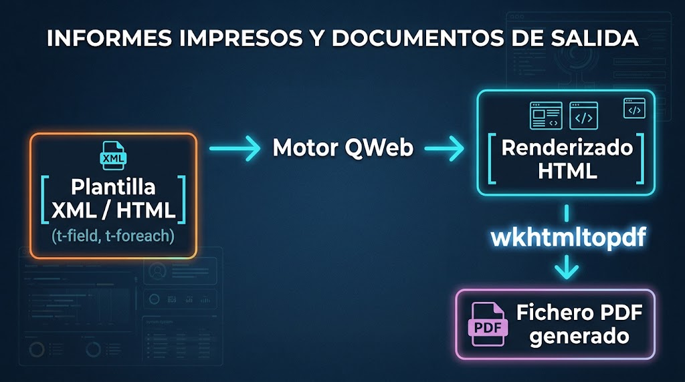

```
┌────────────────────────┐      Motor QWeb       ┌────────────────────────┐
│  Plantilla XML / HTML  │ ────────────────────> │  Renderizado HTML      │
│  (t-field, t-foreach)  │                       └───────────┬────────────┘
└────────────────────────┘                                   │
                                                        wkhtmltopdf
                                                             ▼
                                                 ┌────────────────────────┐
                                                 │  Fichero PDF generado  │
                                                 └────────────────────────┘

```

La implementación de un informe requiere dos elementos:

### 1. La Acción de Reporte (`ir.actions.report`)

Declara el informe en el sistema para que aparezca dentro del menú contextual *Imprimir* del formulario:

```xml
<record id="action_report_ficha_alumno" model="ir.actions.report">
    <field name="name">Ficha de Alumno</field>
    <field name="model">gestion.alumnos</field>
    <field name="report_type">qweb-pdf</field>
    <field name="report_name">gestion_escolar.report_ficha_alumno_document</field>
    <field name="print_report_name">'Ficha_%s' % (object.name)</field>
    <field name="binding_model_id" ref="model_gestion_alumnos"/>
    <field name="binding_type">report</field>
</record>

```

### 2. La Plantilla QWeb del documento

Define la estructura visual y los datos dinámicos a renderizar utilizando directivas `t-*`:

```xml
<template id="report_ficha_alumno_document">
    <t t-call="web.html_container">
        <!-- Itera sobre cada registro seleccionado para imprimir -->
        <t t-foreach="docs" t-as="doc">
            <t t-call="web.external_layout">
                <div class="page">
                    <h2>Expediente del Alumno</h2>
                    
                    <p><strong>Nombre:</strong> <span t-field="doc.name"/></p>
                    <p><strong>DNI:</strong> <span t-field="doc.dni"/></p>
                    <p><strong>Calificación Media:</strong> <span t-field="doc.calificacion"/></p>

                    <h4 class="mt-4">Módulos Cursados</h4>
                    <table class="table table-sm table-bordered">
                        <thead>
                            <tr>
                                <th>Módulo</th>
                                <th>Nota</th>
                            </tr>
                        </thead>
                        <tbody>
                            <tr t-foreach="doc.matricula_ids" t-as="linea">
                                <td><span t-field="linea.modulo_id.name"/></td>
                                <td><span t-field="linea.nota_final"/></td>
                            </tr>
                        </tbody>
                    </table>
                </div>
            </t>
        </t>
    </t>
</template>

```

* `web.external_layout`: Inyecta automáticamente el membrete de la empresa, logotipo corporativo y pie de página legal configurados en el ERP.
* `t-field`: Imprime el valor del campo formateándolo según su tipo (fechas en el formato local, importes con el símbolo monetario adecuado) y manteniendo la reactividad.
* `t-foreach`: Bucle iterativo para renderizar tablas relacionales de líneas de detalle.


# 3. Tratamiento de la información y lógica de negocio

En un sistema ERP corporativo, el tratamiento de la información va más allá del almacenamiento estático de registros en tablas: consiste en la **orquestación de flujos de trabajo**, la **gestión de máquinas de estados** y la **ejecución de reglas de negocio** que garantizan la integridad operativa y contable entre departamentos interconectados.

---

## 3.1. Flujos operativos y transaccionales entre módulos

El valor diferencial de un ERP radica en que una acción originada en un área funcional desencadena automáticamente procesos en cascada en las demás áreas, manteniendo la coherencia transaccional (propiedades ACID) y evitando la duplicidad de datos.

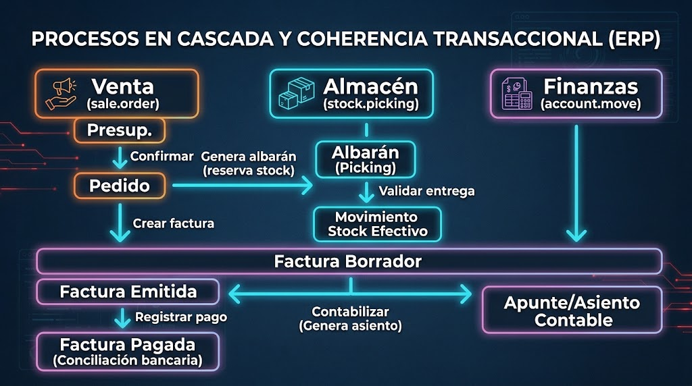

```
  [ Venta ]                   [ Almacén ]                  [ Finanzas ]
  sale.order                 stock.picking                 account.move
 ┌──────────┐               ┌─────────────┐               ┌────────────┐
 │ Presup.  │               │             │               │            │
 └────┬─────┘               │             │               │            │
      │ Confirmar           │             │               │            │
      ▼                     │             │               │            │
 ┌──────────┐ Genera albarán│             │               │            │
 │  Pedido  ├──────────────>│   Albarán   │               │            │
 └────┬─────┘ (reserva stock│  (Picking)  │               │            │
      │                     └──────┬──────┘               │            │
      │ Crear                      │ Validar entrega      │            │
      │ factura                    ▼                      │            │
      │                      Movimiento                   │            │
      │                     Stock Efectivo                │            │
      ▼                                                   ▼            │
 ┌────────────────────────────────────────────────────────┴────────┐   │
 │                         Factura Borrador                        │   │
 └────────────────────────────────┬────────────────────────────────┘   │
                                  │ Contabilizar (Genera asiento)      │
                                  ▼                                    ▼
                         ┌─────────────────┐                  ┌────────┴──────┐
                         │ Factura Emitida │                  │ Apunte/Asiento│
                         └────────┬────────┘                  │  Contable     │
                                  │ Registrar pago            └───────────────┘
                                  ▼
                         ┌─────────────────┐
                         │ Factura Pagada  │ (Conciliación bancaria)
                         └─────────────────┘

```

### Ciclo documental integrado: Venta $\rightarrow$ Logística $\rightarrow$ Contabilidad

1. **Ciclo de Ventas (`sale.order`):**
* El proceso se inicia con una cotización o presupuesto en estado borrador (`draft`).
* Al recibir la conformidad del cliente, se ejecuta el método de confirmación (`action_confirm`), cambiando el estado a pedido de venta en firme (`sale`).
2. **Ciclo de Logística y Trazabilidad (`stock.picking` / `stock.move`):**
* La confirmación del pedido genera de manera transparente un albarán de salida o albarán de entrega.
* El sistema verifica la disponibilidad de existencias en el inventario. Si hay stock, realiza una reserva virtual. Al validar la salida física de mercancía (`button_validate`), el albarán pasa al estado transferido (`done`) y se descuenta el inventario real mediante movimientos de stock trazables.
3. **Ciclo de Facturación y Contabilidad (`account.move`):**
* Según la política configurada (facturar cantidades pedidas o cantidades entregadas), el sistema habilita la creación de la factura.
* La factura nace en estado borrador (`draft`) para permitir su revisión. Al validarse (`action_post`), adquiere un número secuencial oficial correlativo e inmutable y genera automáticamente el asiento contable con sus apuntes deudores y acreedores en las cuentas correspondientes.
* Al registrarse el cobro, la factura cambia a pagada (`paid`) y queda conciliada con la cuenta bancaria o de caja.


### Máquinas de estados y consistencia

Para controlar estos flujos, los modelos implementan un campo técnico de selección denominado habitualmente `state`:

* **Transiciones controladas:** Un registro solo puede transitar de un estado a otro invocando métodos específicos (asociados a botones en la cabecera `<header>` del formulario).
* **Inmutabilidad:** Determinados estados (como `done`, `posted` o `cancel`) bloquean la modificación directa de los campos del registro mediante directivas `readonly="state != 'draft'"`, garantizando que la información legal o contable no pueda manipularse tras su consolidación.

---

## 3.2. Lógica de negocio en servidor frente a procedimientos en base de datos

En el software de gestión tradicional se utilizaban **disparadores** (*triggers*) y **procedimientos almacenados** (*stored procedures*) programados directamente en el motor de base de datos relacional (PL/pgSQL en PostgreSQL). En las arquitecturas modernas basadas en ORM, este patrón se considera un **grave error de diseño**.

### Por qué NO implementar lógica en el gestor de base de datos (PostgreSQL)

| Aspecto                    | Procedimientos almacenados / Triggers SQL                                                                 | Lógica centralizada en el ORM (Python)                                                                     |     |
| -------------------------- | --------------------------------------------------------------------------------------------------------- | ---------------------------------------------------------------------------------------------------------- | --- |
| **Caché del servidor**     | Invalida y corrompe la caché en memoria RAM de Odoo, provocando que los usuarios lean datos desfasados.   | Gestiona y sincroniza la memoria caché en tiempo real de forma atómica.                                    |     |
| **Seguridad y permisos**   | Bypasea las reglas de acceso (`ir.model.access`) y las reglas de registro multicompañía (*record rules*). | Aplica automáticamente las políticas de seguridad del usuario autenticado en cada consulta.                |     |
| **Campos computados**      | No desencadena el recálculo automático de campos dependientes (`@api.depends`).                           | Recalcula en cascada y actualiza en base de datos todos los campos afectados.                              |     |
| **Depuración y logs**      | Difícil de trazar y depurar; oculta errores lógicos dentro del motor de base de datos.                    | Trazas legibles en Python (`Tracebacks`), compatible con debuggers modernos e integrado en el log general. |     |
| **Portabilidad y testing** | Acopla el sistema al RDBMS específico; dificulta los tests unitarios automatizados (`unittest`).          | Código desacoplado, versionable en Git y testeable mediante suites de integración continua.                |     |

---

### Mecanismos del ORM para la lógica de negocio en servidor

Toda la reactividad, validación y cómputo de datos se programa en las clases del modelo utilizando los **decoradores de la API de Odoo**:

#### 1. Campos calculados reactivos: `@api.depends`

Se emplean cuando el valor de un campo debe calcularse automáticamente a partir de otros campos del propio registro o de modelos relacionados.

```python
from odoo import models, fields, api

class AcademiaMatricula(models.Model):
    _name = 'academia.matricula'
    _description = 'Matrícula de Alumno'

    precio_base = fields.Float(string="Precio Base", default=100.0)
    descuento = fields.Float(string="Descuento (%)", default=0.0)
    
    # Campo calculado. Si store=True, se guarda en PostgreSQL; si no, se calcula en memoria al vuelo.
    precio_total = fields.Float(
        string="Total a Pagar", 
        compute="_compute_precio_total", 
        store=True
    )

    @api.depends('precio_base', 'descuento')
    def _compute_precio_total(self):
        for record in self:
            descuento_aplicado = record.precio_base * (record.descuento / 100.0)
            record.precio_total = record.precio_base - descuento_aplicado

```

* **`store=True`:** Hace que el valor se almacene físicamente en la columna de la tabla de PostgreSQL. El ORM solo vuelve a ejecutar la función de cálculo cuando detecta que alguno de los campos declarados en `@api.depends` (`precio_base` o `descuento`) ha cambiado en la base de datos.
* **Procesamiento de recordsets:** La función siempre debe iterar sobre `self` (`for record in self:`) porque el ORM puede invocar el cálculo de manera masiva sobre múltiples registros.

---

#### 2. Interactividad en la interfaz de usuario: `@api.onchange`

Se utiliza para modificar valores en el formulario del navegador **en tiempo real mientras el usuario edita**, antes de guardar el registro en la base de datos.

```python
    @api.onchange('alumno_id')
    def _onchange_alumno_id(self):
        if self.alumno_id and self.alumno_id.es_familia_numerosa:
            self.descuento = 20.0
            return {
                'warning': {
                    'title': "Descuento Aplicado",
                    'message': "Se ha aplicado un 20% de descuento por familia numerosa.",
                    'type': 'notification'
                }
            }

```

> **Aviso de arquitectura:** `@api.onchange` solo se dispara cuando un usuario interactúa manualmente con el navegador cliente. Si los registros se crean vía código (scripts, llamadas API o procesos batch), las funciones `@api.onchange` **no se ejecutan**. Por ello, nunca debe confiarse la integridad de los datos a un `@api.onchange`; deben usarse campos computados o restricciones.

---

#### 3. Restricciones de negocio e integridad: `@api.constrains`

Sustituyen a los *CHECK constraints* y disparadores de PostgreSQL para validar reglas de negocio complejas antes de confirmar una inserción (`create`) o actualización (`write`).

```python
from odoo.exceptions import ValidationError

    @api.constrains('descuento')
    def _check_descuento_valido(self):
        for record in self:
            if record.descuento < 0.0 or record.descuento > 100.0:
                raise ValidationError("El porcentaje de descuento debe situarse entre 0% y 100%.")

```

Si la condición falla, se lanza una excepción `ValidationError`, lo que provoca que el ORM aborte la transacción, ejecute un `ROLLBACK` en la base de datos y muestre una advertencia emergente clara en la interfaz web.

---

### Acciones de Servidor y Automatizaciones (`ir.actions.server` e `ir.cron`)

Cuando es necesario ejecutar procesos automáticos sin programar nuevos métodos en los modelos de un módulo, el ERP proporciona dos herramientas declarativas en el backend:

1. **Acciones Automatizadas / Disparadores de Evento:**
* Se configuran desde la interfaz técnica vinculadas a un modelo.


* Se disparan ante eventos del ciclo de vida: *Al crear un registro*, *Al actualizar un campo específico* o *Al cumplirse un intervalo de tiempo*.


* Permiten ejecutar acciones predefinidas: enviar un correo electrónico con plantilla, actualizar campos de modelos relacionados o ejecutar un fragmento de código Python seguro.


2. **Tareas Programadas en Servidor (`ir.cron`):**
* Equivalente al demonio `cron` del sistema operativo, pero gestionado a nivel de aplicación dentro de la base de datos de Odoo.
* Ejecutan métodos periódicamente en segundo plano (por ejemplo, comprobar todas las noches a las 02:00 qué facturas están vencidas para enviar reclamaciones de cobro automáticas).
* Se definen en ficheros XML mediante registros en el modelo `ir.cron`:


```xml
<record id="ir_cron_comprobar_matriculas_expiradas" model="ir.cron">
    <field name="name">Gestión Académica: Comprobar Matrículas Expiradas</field>
    <field name="model_id" ref="model_academia_matricula"/>
    <field name="state">code</field>
    <field name="code">model._comprobar_vencimientos()</field>
    <field name="interval_number">1</field>
    <field name="interval_type">days</field>
    <field name="numbercall">-1</field>
    <field name="active">True</field>
</record>

```


# 4. Extracción, migración e integración de datos

En el ciclo de vida de un ERP, los datos no permanecen aislados dentro de la base de datos transaccional: deben migrarse desde sistemas heredados (*legacy*), exportarse periódicamente para informes o auditorías, e intercambiarse en tiempo real con aplicaciones satélite (tiendas online, aplicaciones móviles, pasarelas logísticas o plataformas de análisis).

---

## 4.1. Importación y exportación masiva de datos (CSV / XLSX)

La carga inicial y la extracción periódica de grandes volúmenes de datos se realiza habitualmente mediante archivos estructurados en formato **CSV** (*Comma-Separated Values*) o **XLSX**.

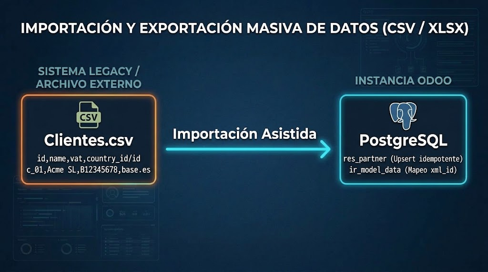

```
  SISTEMA LEGACY / ARCHIVO EXTERNO                     INSTANCIA ODOO
 ┌───────────────────────────────────┐             ┌─────────────────────┐
 │ Clientes.csv                      │             │ PostgreSQL          │
 │ id,name,vat,country_id/id         │             │                     │
 │ c_01,Acme SL,B12345678,base.es    ├────────────>│ res_partner         │
 └───────────────────────────────────┘  Importación│ (Upsert idempotente)│
                                        Asistida   │                     │
                                                   │ ir_model_data       │
                                                   │ (Mapeo xml_id)      │
                                                   └─────────────────────┘

```

### El concepto de Identificador Externo (`xml_id`)

A la hora de importar o exportar datos relacionados, el mayor error técnico consiste en vincular registros utilizando los identificadores numéricos de base de datos (`id` entero autoincremental de PostgreSQL). Los IDs autonuméricos varían entre distintas máquinas, entornos de desarrollo, preproducción y producción.

Para garantizar la integridad y la repetibilidad de las importaciones se utiliza el **Identificador Externo** (o **XML ID** / `xml_id`):

* **Estructura:** Es una cadena alfanumérica única en formato `nombre_modulo.identificador_unico` (por ejemplo, `base.es` para el registro del país España o `mi_empresa.cliente_acme_01`).


* **Tabla `ir.model.data`:** El ERP mantiene una tabla interna que vincula cada `xml_id` con el ID numérico real que ese registro tiene en su tabla física.
* **Idempotencia (*Upsert*):** Si se importa un registro con un `xml_id` que no existe en el sistema, Odoo ejecuta una inserción (`INSERT`). Si el `xml_id` ya existía, ejecuta una actualización (`UPDATE`), evitando duplicados al relanzar importaciones corregidas.

---

### Mapeo de campos relacionales en ficheros planos

Al importar datos que contienen relaciones entre diferentes modelos, la estructura del fichero plano debe reflejar el tipo de relación:

#### 1. Campos `Many2one`

Se debe indicar qué identificador se utiliza para localizar el registro de destino en la otra tabla. Aunque se puede buscar por el nombre visible, la buena práctica exige mapear mediante su identificador externo:

```text
id,name,vat,country_id/id
empresa_001,Distribuciones Norte S.L.,B98765432,base.es
empresa_002,Servicios Sur S.A.,A12345678,base.es

```

#### 2. Campos `One2many` (Cabeceras y líneas de detalle)

Un archivo plano CSV no cuenta con estructura jerárquica nativa. Para importar documentos compuestos por una cabecera y múltiples líneas (por ejemplo, una orden de venta con varias líneas de producto o un contacto con múltiples direcciones de entrega), se utiliza la convención de **filas vacías en la cabecera**:

```text
id,partner_id/id,order_line/product_id/id,order_line/product_uom_qty,order_line/price_unit
pedido_001,empresa_001,product.product_1,2.0,150.00
,,product.product_2,1.0,45.50
,,product.product_3,10.0,12.00
pedido_002,empresa_002,product.product_1,1.0,150.00

```

* Las filas que tienen la primera columna vacía son interpretadas por el importador como elementos secundarios (`order_line`) pertenecientes a la cabecera declarada inmediatamente arriba (`pedido_001`).

#### 3. Campos `Many2many`

Para asignar múltiples etiquetas o categorías a un mismo registro en una sola fila, se separan los identificadores externos mediante comas:

```text
id,name,category_id/id
empresa_001,Distribuciones Norte S.L.,"base.res_partner_category_3,mi_modulo.etiqueta_vip"

```

---

### Flujo técnico de importación asistida

1. **Selección del modelo y descarga de plantilla:** Desde la vista de lista del modelo destino (*Favoritos $\rightarrow$ Importar registros*), se puede descargar una plantilla compatible con las columnas deseadas.
2. **Mapeo de columnas:** El asistente asocia de manera predictiva los encabezados del archivo con los campos del modelo Python.
3. **Validación en seco (*Test Import*):** Antes de persistir ningún cambio en PostgreSQL, el framework ejecuta una transacción temporal donde evalúa tipos de datos, restricciones de modelo (`@api.constrains`) y existencia de claves foráneas. Si se detecta un error en la fila 400 de 5000, aborta la operación completa indicando la fila y el campo conflictivo.
4. **Persistencia masiva:** Al superar el test, se confirma la transacción e inyecta los registros a través del ORM, garantizando que los campos computados y los valores por defecto queden inicializados.

---

## 4.2. Integración externa y consumo de información

En arquitecturas empresariales modernas, el intercambio de datos entre sistemas no se efectúa mediante traspasos manuales de archivos, sino mediante **comunicación máquina a máquina a través de APIs de red**.

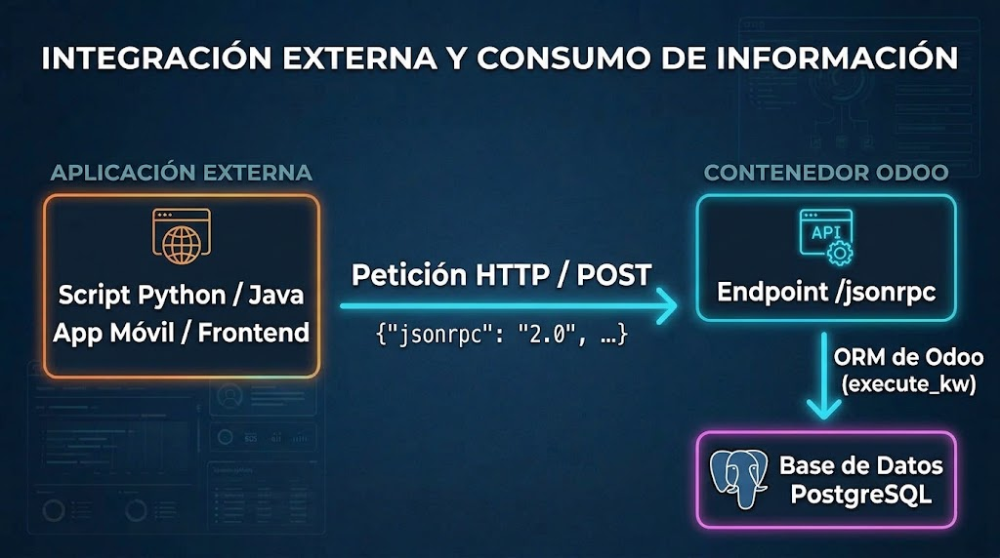

```
  APLICACIÓN EXTERNA                                    CONTENEDOR ODOO
 ┌──────────────────────┐   Petición HTTP / POST     ┌─────────────────────┐
 │ Script Python / Java │ ─────────────────────────> │ Endpoint /jsonrpc   │
 │ App Móvil / Frontend │   {"jsonrpc": "2.0", ...}  └──────────┬──────────┘
 └──────────────────────┘                                       │
                                                           ORM de Odoo
                                                        (execute_kw)
                                                                ▼
                                                     ┌─────────────────────┐
                                                     │ Base de Datos       │
                                                     │ PostgreSQL          │
                                                     └─────────────────────┘

```

### Integración programática mediante la API JSON-RPC nativa

Odoo expone de fábrica un punto de entrada sobre protocolo **JSON-RPC** en la ruta `/jsonrpc` (así como compatibilidad con XML-RPC). Cualquier aplicación externa escrita en Python, Java, C# o JavaScript puede autenticarse e invocar métodos del ORM de manera remota.

El flujo de integración programática consta de dos pasos:

1. **Autenticación:** Envío de credenciales (base de datos, usuario y clave/API Key) al servicio `common` para obtener el identificador de usuario (`uid`).
2. **Ejecución de operaciones:** Invocación del servicio `object` utilizando la función `execute_kw`, pasando el modelo, el método ORM (`search`, `read`, `create`, `write`), y los argumentos.

#### Ejemplo práctico: Cliente externo en Python que consulta clientes del ERP

```python
import json
import urllib.request

URL = "http://localhost:8069/jsonrpc"
DB = "odoo_dev"
USER = "admin@empresa.com"
PASSWORD = "admin_password"  # En producción se debe usar una API Key

def call(service, method, *args):
    payload = json.dumps({
        "jsonrpc": "2.0",
        "method": "call",
        "params": {
            "service": service,
            "method": method,
            "args": args
        },
        "id": 1
    }).encode("utf-8")
    
    req = urllib.request.Request(URL, data=payload, headers={"Content-Type": "application/json"})
    with urllib.request.urlopen(req) as response:
        result = json.loads(response.read().decode("utf-8"))
        if "error" in result:
            raise Exception(result["error"])
        return result["result"]

# 1. Autenticación y obtención del User ID (uid)
uid = call("common", "authenticate", DB, USER, PASSWORD, {})
print(f"Autenticado correctamente con UID: {uid}")

# 2. Invocación remota del método 'search_read' sobre el modelo 'res.partner'
clientes = call(
    "object", 
    "execute_kw", 
    DB, 
    uid, 
    PASSWORD,
    "res.partner",           # Modelo
    "search_read",           # Método ORM
    [[("is_company", "=", True)]],  # Dominio de búsqueda
    {"fields": ["name", "email", "vat"], "limit": 5} # Parámetros
)

for cliente in clientes:
    print(f"Empresa: {cliente['name']} | CIF/NIF: {cliente.get('vat')} | Email: {cliente.get('email')}")

```

Este mecanismo permite construir integraciones desacopladas:

* Sincronizar pedidos de un comercio electrónico (WooCommerce, Shopify) llamando al método `create` sobre el modelo `sale.order`.
* Actualizar el estado del stock desde un terminal de radiofrecuencia de almacén.
* Consultar saldos y emitir facturas desde aplicaciones móviles corporativas.

---

### Extracción para Business Intelligence (BI) y analítica de datos

Los sistemas ERP operan bajo el paradigma **OLTP** (*Online Transaction Processing*), diseñado para gestionar miles de pequeñas transacciones concurrentes (crear una línea de factura, cambiar un estado de pedido, mover una unidad de stock) garantizando tiempo de respuesta inmediato y consistencia ACID.

Cuando la dirección de una empresa necesita análisis macroeconómico, informes de tendencias o análisis multidimensionales de ventas históricas, el procesado cambia al paradigma **OLAP** (*Online Analytical Processing* o Business Intelligence):

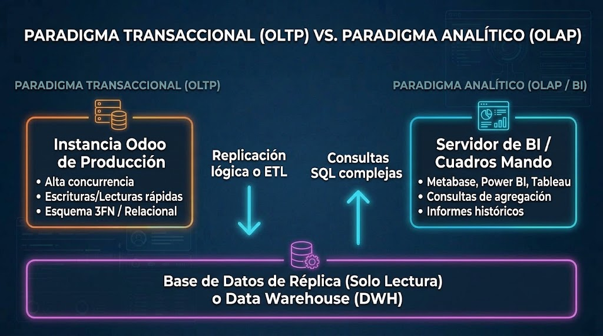

```
  PARADIGMA TRANSACCIONAL (OLTP)            PARADIGMA ANALÍTICO (OLAP / BI)
 ┌──────────────────────────────┐          ┌──────────────────────────────┐
 │ Instancia Odoo de Producción │          │ Servidor de BI / Cuadros Mando│
 │ - Alta concurrencia          │          │ - Metabase, Power BI, Tableau│
 │ - Escrituras/Lecturas rápidas│          │ - Consultas de agregación    │
 │ - Esquema 3FN / Relacional   │          │ - Informes históricos        │
 └──────────────┬───────────────┘          └──────────────▲───────────────┘
                │                                         │
                │ Replicación lógica o ETL                │ Consultas SQL
                ▼                                         │ complejas
 ┌────────────────────────────────────────────────────────┴───────────────┐
 │ Base de Datos de Réplica (Solo Lectura) o Data Warehouse (DWH)         │
 └────────────────────────────────────────────────────────────────────────┘

```

1. **El problema de las consultas analíticas sobre el ERP:**
* Ejecutar agregaciones masivas (`SUM`, `AVG`, `GROUP BY` sobre millones de registros históricos) directamente contra la base de datos principal de Odoo bloquea tablas y agota las conexiones del pool de PostgreSQL, degradando el rendimiento para los usuarios que están facturando o vendiendo en tiempo real.


2. **Soluciones arquitectónicas modernas:**
* **Modelos SQL de Odoo (`_auto = False`):** Para informes internos, Odoo permite crear modelos que no generan tablas físicas, sino **vistas SQL en PostgreSQL** (`CREATE OR REPLACE VIEW`). Estas vistas precalculan los joins y cálculos analíticos en la base de datos para mostrarlos mediante vistas `<graph>` o `<pivot>`.
* **Réplica de Base de Datos en Solo Lectura (*Read Replica*):** Las herramientas de análisis (Power BI, Metabase, Grafana) se conectan al puerto PostgreSQL de una réplica asíncrona del servidor de base de datos, aislando el tráfico analítico del servidor de producción.
* **Pipelines ETL hacia Data Warehouses:** Procesos programados extraen datos periódicamente del ERP mediante la API o volcados SQL, los transforman y los cargan en almacenes de datos analíticos (como ClickHouse, Snowflake o BigQuery) para análisis de Business Intelligence a gran escala.


# 5. Evaluación del rendimiento, auditoría y resolución de incidencias

En un entorno de producción o desarrollo corporativo, el correcto funcionamiento del ERP depende tanto de la salud de la infraestructura subyacente como de la calidad del código desplegado. Administrar y depurar un ERP moderno exige supervisar el consumo de recursos de los contenedores, interpretar las trazas de ejecución en tiempo real y conocer los protocolos de recuperación ante fallos en los módulos.

---

## 5.1. Monitorización del stack en entornos contenerizados

En arquitecturas tradicionales se recurría a herramientas de bajo nivel del sistema operativo anfitrión (como el comando `sar` del paquete `sysstat`). En entornos contenerizados con Docker Compose, estas herramientas pierden eficacia práctica porque no discriminan de forma directa el consumo individualizado de cada microservicio o contenedor.


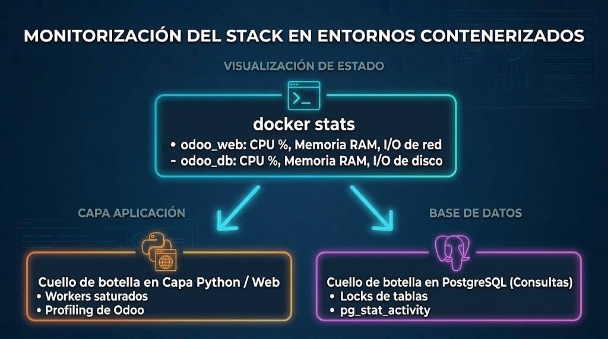

```
┌────────────────────────────────────────────────────────┐
│                   docker stats                         │
│  - odoo_web: CPU %, Memoria RAM, I/O de red            │
│  - odoo_db:  CPU %, Memoria RAM, I/O de disco          │
└──────────────┬──────────────────────────┬──────────────┘
               │                          │
               ▼                          ▼
 ┌───────────────────────────┐ ┌─────────────────────────┐
 │   Cuello de botella en    │ │   Cuello de botella en  │
 │   Capa Python / Web       │ │   PostgreSQL (Consultas)│
 │   - Workers saturados     │ │   - Locks de tablas     │
 │   - Profiling de Odoo     │ │   - pg_stat_activity    │
 └───────────────────────────┘ └─────────────────────────┘

```

### 1. Monitorización de métricas de recursos con Docker

La herramienta nativa `docker stats` ofrece una visión en tiempo real del uso de CPU, memoria RAM, límites asignados e impacto en disco y red de los servicios del ERP:

```bash
docker stats odoo_web odoo_db

```

* **Consumo de memoria en `odoo_web`:** Un incremento lineal sostenido de memoria sin estabilización suele indicar fugas de memoria (*memory leaks*) provocadas por la instanciación de recordsets masivos en Python sin paginación.
* **I/O de disco en `odoo_db`:** Tasas elevadas de lectura/escritura continua en PostgreSQL delatan la falta de índices en campos calculados almacenados (`store=True`) o búsquedas frecuentes sobre columnas de texto no indexadas.

---

### 2. Detección de bloqueos y consultas lentas en PostgreSQL

Dado que Odoo centraliza todas sus operaciones en la base de datos, las degradaciones de rendimiento suelen originarse por contención de bloqueos (*locks*) o transacciones abiertas que no se confirman:

```sql
-- Inspección de conexiones activas y consultas en ejecución
SELECT pid, usename, state, age(clock_timestamp(), query_start) AS duracion, query
FROM pg_stat_activity
WHERE state != 'idle' AND query NOT ILIKE '%pg_stat_activity%'
ORDER BY duracion DESC;

```

Si una consulta permanece en ejecución durante varios minutos bloqueando tablas críticas (como `account_move` o `stock_quant`), puede terminarse de forma controlada desde el cliente SQL mediante:

```sql
SELECT pg_cancel_backend(pid_del_proceso);

```

---

### 3. Generación de perfiles (*Profiling*) en Odoo

Para diagnosticar la lentitud en la carga de una vista o la ejecución de una acción específica, el ERP integra una herramienta nativa de **Profiling**:

1. **Activación:** Con el modo desarrollador activo (`?debug=1`), pulsar sobre el icono del escarabajo en la barra superior y seleccionar **Iniciar generación de perfiles** (*Start Profiling*).
2. **Inspección de tiempos:** El motor desglosa el tiempo total de la petición web en:
* **Tiempo en Backend (Python):** Ejecución de la lógica de negocio y ensamblado de datos.
* **Tiempo en Base de Datos (SQL):** Número de consultas lanzadas y milisegundos totales consumidos por PostgreSQL.
* **Tiempo en Frontend (OWL/JS):** Renderizado de componentes en el navegador cliente.


3. **Diagnóstico del problema $N+1$:** Esta herramienta permite detectar si un método dentro de un bucle lanza cientos de consultas individuales repetitivas a la base de datos en lugar de realizar una única consulta agrupada sobre el recordset.

---

## 5.2. Trazas del sistema (logs) y auditoría de accesos

El registro de actividad del servidor constituye la principal fuente de información para verificar el despliegue y diagnosticar anomalías.

### 1. Extracción de logs en tiempo real

En un despliegue contenerizado, la salida estándar del servidor no se consulta mediante editores de texto tradicionales en `/var/log`, sino a través del flujo de eventos de Docker Compose:

```bash
# Seguir el log del servicio web en tiempo real
docker compose logs -f web

# Inspeccionar las últimas 200 líneas y pausar
docker compose logs --tail=200 web

```

---

### 2. Anatomía de una traza de log en Odoo

Cada línea emitida por el framework sigue una estructura uniforme:

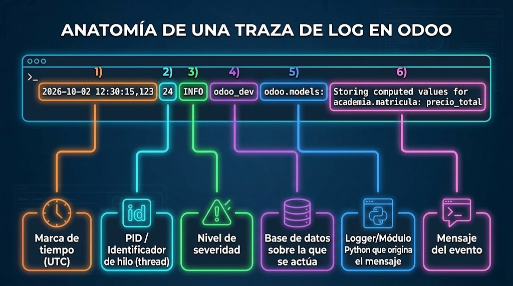

```text
2026-10-02 12:30:15,123 24 INFO odoo_dev odoo.models: Storing computed values for academia.matricula: precio_total
──────┬───────────────── ── ──┬─ ────┬─── ─────┬───── ──────────────────────────┬─────────────────────────────
      │                   │   │      │         │                                └─ Mensaje del evento
      │                   │   │      │         └─ Logger/Módulo Python que origina el mensaje
      │                   │   │      └─ Base de datos sobre la que se actúa
      │                   │   └─ Nivel de severidad
      │                   └─ PID / Identificador de hilo (thread)
      └─ Marca de tiempo (UTC)

```

Niveles de severidad estándar:

* **`DEBUG`:** Información de diagnóstico de bajo nivel (consultas SQL detalladas, carga de assets). Requiere arrancar el servidor con `--log-level=debug`.
* **`INFO`:** Eventos operativos habituales (arranque de servicios web en el puerto 8069, carga de ficheros estáticos, actualización de módulos).
* **`WARNING`:** Avisos de inconsistencias no fatales (librerías de Python opcionales no encontradas, llamadas a métodos obsoletos / *deprecated*).
* **`ERROR`:** Fallos funcionales durante la ejecución de una petición (fallo de validación, error de sintaxis en plantillas QWeb, permisos denegados).
* **`CRITICAL`:** Errores irreversibles que impiden el funcionamiento del servidor (imposibilidad de conectar con el contenedor de base de datos, fichero de configuración inaccesible).

---

### 3. Interpretación de *Tracebacks* de Python

Cuando se produce una excepción no controlada en un módulo personalizado, Odoo imprime una traza de pila de llamadas (*Traceback*). En Python, las trazas se leen **de arriba hacia abajo** en orden cronológico, situándose la causa raíz en la última línea:

```text
ERROR odoo_dev odoo.http: Exception during request
Traceback (most recent call last):
  File "/usr/lib/python3/dist-packages/odoo/http.py", line 1998, in _serve_db
    return service_model.retrying(self._serve_ir_http, self.env)
  ...
  File "/mnt/extra-addons/gestion_escolar/models/matricula.py", line 28, in _compute_precio_total
    record.precio_total = record.precio_base / record.descuento
ZeroDivisionError: division by zero

```

* **Localización del fichero:** La línea previa al error indica el archivo exacto (`matricula.py`), la línea de código (`line 28`) y el método involucrado (`_compute_precio_total`).
* **Tipo de excepción:** `ZeroDivisionError: division by zero` especifica con claridad que el cálculo intentó dividir entre un descuento igual a 0.

---

### 4. Auditoría funcional de datos: El patrón `mail.thread`

Para auditar qué usuario modificó un registro y cuándo, además de las columnas del sistema (`create_uid`, `write_date`), Odoo proporciona el mecanismo de **seguimiento de campos (*Chatter*)**.

Al heredar el mixin `mail.thread` en un modelo de Python, se puede habilitar la auditoría campo a campo mediante el atributo `tracking=True`:

```python
class AcademiaMatricula(models.Model):
    _name = 'academia.matricula'
    _inherit = ['mail.thread']

    # Cada vez que este campo cambie, el ERP registrará en el chatter:
    # "Usuario X cambió Estado de 'Borrador' a 'Matriculado' el [Fecha]"
    state = fields.Selection([
        ('borrador', 'Borrador'),
        ('matriculado', 'Matriculado')
    ], default='borrador', tracking=True)

```

---

## 5.3. Diagnóstico y resolución de incidencias comunes de desarrollo

Durante el ciclo de desarrollo y despliegue de módulos personalizados, los fallos más frecuentes responden a tres casuísticas:

### 1. Errores de validación XML durante la actualización del módulo

Si un archivo XML contiene errores de sintaxis, identificadores inexistentes o selectores XPath mal construidos, el framework bloquea la actualización y lanza una excepción de tipo `ParseError`:

* **Error por nodo XPath no encontrado:**
```text
odoo.tools.convert.ParseError: Element '<xpath expr="//field[@name=\'campo_falso\']">' cannot be located in parent view

```


* *Causa:* El campo `campo_falso` no existe en la vista padre que se intenta heredar (`inherit_id`).
* *Solución:* Revisar la definición técnica de la vista original desde *Ajustes $\rightarrow$ Técnico $\rightarrow$ Interfaz de usuario $\rightarrow$ Vistas* y comprobar el nombre exacto del elemento de referencia.


* **Error por ID externo duplicado o no declarado:**
```text
ValueError: External ID not found in the system: base.id_no_existente

```


* *Causa:* Se intenta hacer referencia a un registro (`ref="..."`) que pertenece a un módulo no instalado o cuyo identificador XML no coincide con el definido en el sistema.


---

### 2. Conflictos de dependencias en el manifiesto (`__manifest__.py`)

Si un modelo personalizado hereda de `sale.order` o utiliza campos de `res.partner`, pero en el fichero `__manifest__.py` no se declaran explícitamente esas dependencias en la clave `depends`:

* El módulo puede instalarse erróneamente si los otros módulos ya estaban activos en esa base de datos concreta, pero fallará de forma crítica si se despliega en una base de datos limpia o en un servidor de producción.
* *Solución:* Declarar siempre todas las dependencias funcionales requeridas:
```python
'depends': ['base', 'sale_management', 'account'],

```


---

### 3. Protocolo de recuperación ante caídas del servidor (*Boot Loop*)

Un error común en desarrollo consiste en introducir un error de sintaxis de Python o un método corrupto en un módulo que arranca automáticamente al iniciar el contenedor. Como consecuencia, el servicio web de Odoo cae y se reinicia en bucle continuo, impidiendo el acceso a la interfaz web para desinstalarlo.

Para recuperar el sistema sin destruir la base de datos se debe seguir el siguiente procedimiento técnico:

1. **Detener el reinicio automático del contenedor:**
```bash
docker compose stop web

```


2. **Ejecutar un contenedor efímero en modo interactivo sobreescribiendo el punto de entrada:**
```bash
docker compose run --rm web odoo shell -d nombre_bd

```


3. **Desinstalar o desactivar el módulo defectuoso desde la shell de Odoo:**
```python
# Buscar el registro del módulo conflictivo en la tabla ir.module.module
modulo = env['ir.module.module'].search([('name', '=', 'modulo_defectuoso')])

# Forzar su desinstalación limpia en la base de datos
modulo.button_immediate_uninstall()

# Confirmar la transacción
env.cr.commit()
exit()
```


4. **Reanudar el servicio normal:**
5. 
Una vez desinstalado el módulo roto desde la shell, se levanta el stack habitual y el servidor web volverá a responder con normalidad:
```bash
docker compose up -d web
```