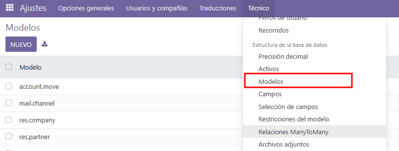
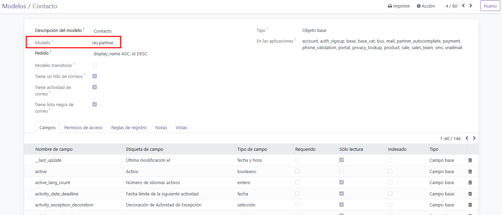
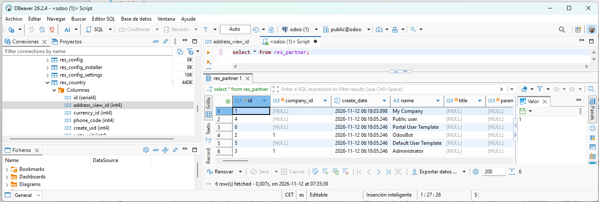
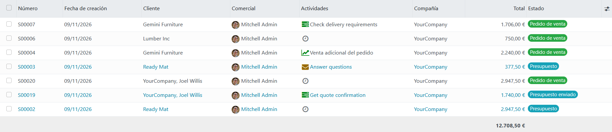
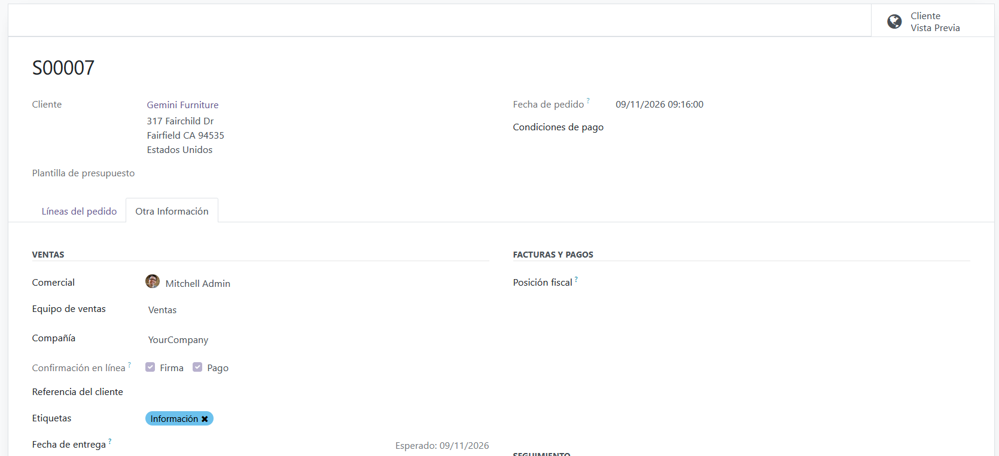
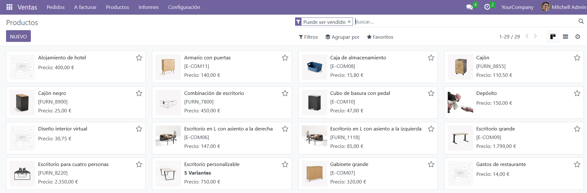
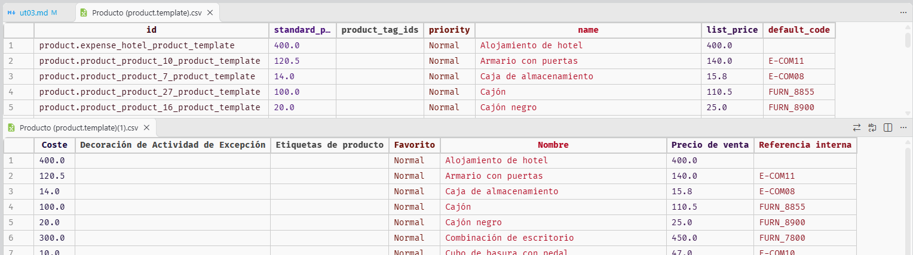
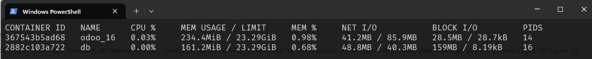
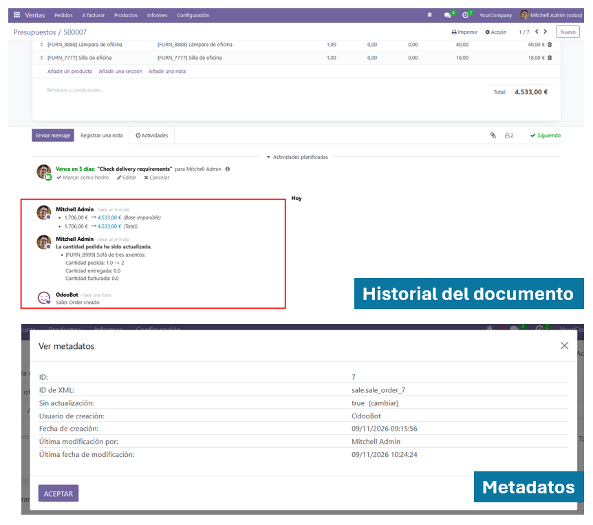
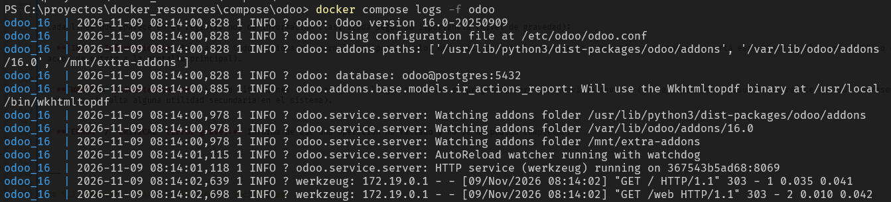

```
-------------------- SISTEMAS DE GESTIÓN EMPRESARIAL - DMOL ---------------------
---------------------------------------------------------------------------------

Módulo:                     SISTEMAS DE GESTIÓN EMPRESARIAL
Profesor:                   Víctor J. González
Unidad de Trabajo:          UT03. Organización, consulta y tratamiento de la información
Resultados de aprendizaje:  RA3
```

# UT03: ORGANIZACIÓN, CONSULTA Y TRATAMIENTO DE LA INFORMACIÓN

# 1. Organización y consulta de la información en el ERP

## 1.1. Arquitectura de datos del ERP: El ORM frente al modelo relacional

En el desarrollo de software corporativo contemporáneo, un ERP no interactúa con el motor de base de datos ejecutando sentencias SQL tradicionales escritas a mano. En su lugar, implementa un **ORM** (*Object-Relational Mapping* o Mapeo Objeto-Relacional).

El ORM actúa como una capa de abstracción bidireccional que traduce las clases y objetos definidos en el código fuente (Python en el caso de Odoo) en entidades, tablas y relaciones dentro del Sistema Gestor de Bases de Datos Relacionales (PostgreSQL).


### Reglas de persistencia y convención de nombres

1. **Identificadores de tabla:** por convención técnica, el atributo `_name` de un modelo Python sustituye los puntos por guiones bajos al materializarse en la base de datos. Por ejemplo:
   - El modelo `res.partner` se almacena físicamente en la tabla `res_partner`.
   - El modelo `sale.order` se almacena físicamente en la tabla `sale_order`.
   - El modelo `account.move` se almacena físicamente en la tabla `account_move`.
2. **Clave primaria implícita (`id`):** todo modelo administrado por el ORM genera automáticamente una columna de clave primaria entera, autonumérica y única denominada `id`. Los desarrolladores nunca declaran este campo manualmente en el código.
3. **Campos del sistema y auditoría obligatoria:** en cada inserción o modificación, el ORM inyecta y mantiene automáticamente cuatro campos técnicos para auditoría interna:
- `create_uid`: Clave foránea al usuario (`res_users`) que insertó el registro.
- `create_date`: Marca temporal UTC de inserción.
- `write_uid`: Clave foránea al último usuario que modificó el registro.
- `write_date`: Marca temporal UTC de la última modificación.


### Mapeo de tipos y relaciones de datos

El ORM traduce los tipos de datos de alto nivel a tipos nativos del gestor relacional:

| Tipo en ORM (Python)              | Tipo físico en PostgreSQL      | Comportamiento relacional / Almacenamiento                                                                    |
| --------------------------------- | ------------------------------ | ------------------------------------------------------------------------------------------------------------- |
| `fields.Char`                     | `VARCHAR`                      | Cadenas cortas de texto indexables (monolínea).                                                               |
| `fields.Text`                     | `TEXT`                         | Bloques extensos de texto multilinea.                                                                         |
| `fields.Integer`                  | `INTEGER` / `INT4`             | Valores numéricos enteros.                                                                                    |
| `fields.Float`                    | `NUMERIC` o `FLOAT8`           | Valores decimales con precisión configurable.                                                                 |
| `fields.Boolean`                  | `BOOLEAN`                      | Valores lógicos (`true`/`false`).                                                                             |
| `fields.Date` / `fields.Datetime` | `DATE` / `TIMESTAMP`           | Fechas y marcas de tiempo UTC.                                                                                |
| `fields.Many2one`                 | `INTEGER REFERENCES tabla(id)` | Crea una columna física de clave foránea con sufijo `_id` e integridad referencial .                          |
| `fields.One2many`                 | *Ninguno (Virtual)*            | No genera columnas en la tabla física de origen; consulta las claves foráneas existentes en la tabla destino. |
| `fields.Many2many`                | `TABLA INTERMEDIA`             | Genera una tabla de unión física con dos columnas de claves foráneas para resolver relaciones $N:M$.          |


### Modelos maestros transversales

El diseño de la base de datos se articula alrededor de modelos centrales compartidos por todos los módulos funcionales del ERP:

- **`res.partner` (contactos y entidades):** modela tanto a personas físicas como jurídicas. Un único modelo gestiona clientes, proveedores, transportistas, contactos de facturación y direcciones de entrega mediante una estructura jerárquica padre-hijo (`parent_id`) y discriminadores como `is_company` o `type` (`contact`, `invoice`, `delivery`).
- **`res.users` (usuarios del sistema):** registra las credenciales de acceso, configuraciones de idioma y derechos de seguridad. Cada registro de `res.users` tiene una relación 1:1 estricta con una ficha asociada en `res.partner`.
- **`res.company` (rmpresas):** define las unidades de negocio en entornos multicompañía, asociando planes contables, monedas principales y domicilios fiscales específicos.
- **`account.move` (asientos y facturas):** tabla central del módulo financiero donde se registran tanto facturas de clientes, facturas de proveedores como apuntes contables manuales.

### Inspección técnica de modelos desde la interfaz

Para analizar cómo están construidos los modelos sin recurrir a la consola, el ERP ofrece el **Modo Desarrollador** (*Developer Mode*). Para acceder a este modo primero tenemos que haber activado por lo menos un módulo de Odoo (por ejemplo, *Ventas*). Una vez hecho hay dos posibilidades:

- Añadiendo añadiendo `?debug=1` en la URL del navegador
- Desde *Ajustes -> Herramientas de desarrollador -> Activar modo desarrollador*.

Una vez lo tengamos habilitado podremos ver que hay un nuevo menú en *Ajustes -> Técnico*. En ese menú hay un gran número de opciones que nos permitirán acceder a las interioridades de Odoo. Lo más relevante en este caso para nosotros está casi al final en el apartado *Estructura de la base de datos -> Modelos*



Aquí podremos consultar los nombres técnicos de los campos, su tipo de dato, las restricciones SQL activadas, los permisos de acceso asignados por grupo y las vistas en las que interviene cada campo. Por ejemplo, en la siguiente imagen puedes ver los campos de `res.partner`.




## 1.2. Consulta e inspección de datos: Herramientas gráficas vs. ORM

Desde la interfaz gráfica podemos ver la estructura de la base de datos, pero si lo que queremos es ver los datos del ERP, es decir, los almacenados en la base de datos, existen dos vías con propósitos y restricciones claramente diferenciados: la inspección mediante clientes SQL externos y la interacción programática a través del propio ORM.

### A) Inspección externa mediante clientes SQL (DBeaver / pgAdmin)

En un despliegue contenerizado con Docker Compose, el contenedor de base de datos PostgreSQL almacena la totalidad del esquema físico. Herramientas de administración gráfica como **DBeaver** o **pgAdmin 4** se conectan directamente al puerto de PostgreSQL (puerto `5432`). Esta forma de inspeccionar los datos es de **uso exclusivo en desarrollo y auditoría** limitando esta conexión a la **lectura y análisis**. Es útil para evaluar planes de ejecución de consultas pesadas, auditar el crecimiento de tablas de logs o diseñar consultas analíticas para herramientas externas de Business Intelligence.



Pero, ¿por qué está terminantemente prohibido alterar la base de datos por SQL directo? Ejecutar sentencias de modificación (`INSERT`, `UPDATE`, `DELETE`) directamente sobre la base de datos sin pasar por el ORM compromete la estabilidad del ERP debido a cinco factores críticos:

1. **Destrucción de la memoria caché:** el ORM almacena en memoria RAM una caché multinivel de registros y campos. Una modificación directa vía SQL altera los datos en disco, pero el ERP seguirá sirviendo los valores en caché desactualizados, produciendo inconsistencias lógicas.
2. **Omisión de validaciones de negocio:** las reglas de integridad complejas se definen en Python mediante decoradores como `@api.constrains`. Una sentencia SQL omite estas restricciones, permitiendo, por ejemplo, que una factura confirmada vuelva a un estado inconsistente o que un balance descuadre.
3. **Rotura de campos computados (`@api.depends`):** al modificar un valor mediante SQL (por ejemplo, el precio unitario de una línea de pedido), los campos dependientes calculados (subtotal, base imponible, impuestos totales del pedido) **no se recalculan**.
4. **Desactivación de la auditoría y mensajería:** el ERP no actualizará los campos de auditoría (`write_date`, `write_uid`) ni registrará las notas de cambio en el hilo de seguimiento (*chatter* o tabla `mail.message`).
5. **Vulneración de las reglas de seguridad (*Record Rules*):** las restricciones que impiden que un comercial vea clientes de otra delegación o compañía se evalúan dinámicamente en Python; una consulta SQL plana no respeta ninguna de estas políticas de aislamiento.


### B) Consulta e interacción programática mediante el ORM

La vía segura y profesional para consultar o manipular datos fuera de la interfaz web es la consola interactiva del ERP, conocida como **Odoo Shell**. Esta herramienta carga el entorno de ejecución, inicializa la conexión con PostgreSQL y expone la API completa del ORM.

Para abrir la consola dentro del contenedor en ejecución ejecutamos la siguiente orden teniendo en cuenta que `{id_contenedor}` es el identificador del contenedor con Odoo.

```bash
docker exec -ti {id_contenedor} bash
```

Una vez estamos en el contenedor debemos ejecutar `odoo shell` para acceder a la terminal interactiva de Odoo que en realidad es un intérprete Python con acceso a las variables internas de Odoo.

```python
odoo shell -d odoo --db_host=$HOST --db_user=$USER --db_password=$PASSWORD
```
Aquí, la variable `self.env` da acceso a todos los modelos del sistema mediante la sintaxis de diccionario `env['nombre.del.modelo']`. El modelo devuelto dispone de algunos métodos que nos permiten acceder al contenido de la tabla correspondiente.

#### 1. Búsqueda con dominios: método `search()`

El método `search()` recibe como parámetro una lista de tuplas con el formato `(campo, operador, valor)` y devuelve un conjunto de registros (*recordset*):

```python
# Obtener todos los partners que sean empresas radicadas en España
partners_es = env['res.partner'].search([
    ('is_company', '=', True),
    ('country_id.code', '=', 'ES')
])

print(f"Total encontrados: {len(partners_es)}")
for p in partners_es:
    print(f"ID: {p.id} - Nombre: {p.name}")
```

Algunos operadores habituales en dominios de búsqueda son:

- Comparación estándar: `=`, `!=`, `>`, `>=`, `<`, `<=`
- Pertenencia: `in`, `not in` (compara contra listas de valores o IDs)
- Coincidencia de cadenas: `like`, `ilike` (esta última sin distinción entre mayúsculas y minúsculas)
- Operadores lógicos de dominio: Por defecto, los criterios dentro de la lista se evalúan con un operador **AND** implícito. Para evaluar un **OR**, se prefija con el operador `'|'`:
  
```python
# Clientes cuyo nombre contenga 'Tech' O cuyo país sea España
clientes = env['res.partner'].search([
    '|', 
    ('name', 'ilike', 'Tech'), 
    ('country_id.code', '=', 'ES')
])
```


#### 2. Carga por identificador: método `browse()`

Cuando se conoce el identificador numérico de clave primaria (`id`), `browse()` recupera directamente el *recordset* sin necesidad de evaluar filtros de búsqueda:

```python
# Cargar el registro de res.partner cuyo id sea 1
admin_partner = env['res.partner'].browse(1)
print(admin_partner.name, admin_partner.email)
```

#### 3. Optimización para lectura masiva: método `search_read()`

Combina una búsqueda con la extracción selectiva de campos, retornando una lista de diccionarios Python ligera y serializable (ideal para construir servicios web o APIs REST):

```python
# Extrae solo id, name y email de los primeros 5 clientes
datos_clientes = env['res.partner'].search_read(
    domain=[('customer_rank', '>', 0)],
    fields=['name', 'email'],
    limit=5
)
# Retorna: [{'id': 12, 'name': 'Acme Corp', 'email': 'info@acme.com'}, ...]
```


# 2. Visualización de la información: vistas, menús y acciones

La capa de presentación en Odoo se gestiona de forma completamente declarativa mediante ficheros **XML**. A diferencia de los desarrollos convencionales donde la interfaz de usuario se acopla directamente a la lógica de negocio, el ERP implementa un patrón donde las pantallas no se programan de manera imperativa: se describen mediante etiquetas semánticas y el motor web se encarga de interpretarlas y renderizarlas en el navegador.


## 2.1. Arquitectura de la interfaz de usuario basada en XML

Todas las pantallas que visualiza el usuario (formularios, listados, gráficos o diálogos modales) son registros almacenados en la tabla del sistema **`ir.ui.view`**. Al instalar o actualizar un módulo, el framework lee los ficheros XML declarados en un archivo de manifiesto y persiste la estructura en la base de datos.


A continuación puedes ver un ejemplo de cómo es el código XML que corresponde a una vista. En la última unidad de este curso ya veremos con más detalle en qué consiste cada campo:

```xml
<odoo>
    <!-- Definición de la vista tree / lista -->
    <record id="view_mi_modelo_tree" model="ir.ui.view">
        <field name="name">mi.modelo.tree</field>
        <field name="model">mi.modelo</field>
        <field name="arch" type="xml">
            <tree string="Listado de Mis Modelos" decoration-info="estado == 'borrador'" decoration-success="estado == 'confirmado'">
                <field name="name"/>
                <field name="fecha"/>
                <field name="monto" sum="Total"/>
                <field name="estado"/>
            </tree>
        </field>
    </record>
</odoo>
```


Hay diferentes tipos de vistas que Odoo clasifica  según el modo de interacción con el modelo de datos. Algunos ejemplos de tipos de vistas son:

### A) Vistas de lista o árbol

Presentan los registros en formato tabular (filas y columnas). Permiten ordenación por columnas, selección múltiple y edición directa sin abrir el formulario .





### B) Vistas de formulario

Representan un único registro en modo lectura o edición. Siguen una estructura semántica estándar que organiza la pantalla en tres zonas: cabecera, cuerpo y seguimiento.




### C) Vistas de tipo kanban

Representan una serie de registros mediante tarjetas  organizadas en columnas según un campo de estado o etapa. Ideal para flujos de trabajo (CRM, proyectos o incidencias).





## 2.2.- Menús de navegación

Para que el usuario final pueda ejecutar una acción de ventana sin conocer las rutas internas del sistema, Odoo proporciona los elementos de menú, registrados en la tabla `ir.ui.menu`. Los menús se organizan de forma jerárquica (en forma de árbol) dentro de la interfaz:

- **Menú raíz (Nivel 0)**: aparece en el selector principal de aplicaciones (el icono de la esquina superior izquierda). No ejecuta acciones, solo agrupa submenús.
- **Menú de sección (Nivel 1)**: se sitúa en la barra superior horizontal cuando entramos en la aplicación. Puede desplegar más opciones o lanzar una acción directamente.
- **Elemento de menú final (Nivel 2 o superior)**: es la opción clicable dentro de un desplegable que dispara la acción de ventana correspondiente.

En XML, aunque internamente son registros de `ir.ui.menu`, Odoo ofrece la etiqueta abreviada `<menuitem>` para declararlos de forma más limpia y legible. A continuación, tienes un ejemplo de cómo se define un menú en Odoo.

```xml
<odoo>
    <!-- 1. Menú raíz (Aplicación en el cajón principal) -->
    <menuitem id="menu_mi_modulo_root" 
              name="Mi Aplicación" 
              sequence="10"/>

    <!-- 2. Submenú en la barra superior -->
    <menuitem id="menu_mi_modulo_operaciones" 
              name="Operaciones" 
              parent="menu_mi_modulo_root" 
              sequence="10"/>

    <!-- 3. Menú final que ejecuta la acción de ventana -->
    <menuitem id="menu_mi_modelo" 
              name="Mis Modelos" 
              parent="menu_mi_modulo_operaciones" 
              action="action_mi_modelo" 
              sequence="10"/>
</odoo>
```


## 2.3.- Acciones de ventana

Por sí solas, las vistas son solo plantillas de diseño pasivas almacenadas en la base de datos; necesitan un mecanismo que indique al sistema qué modelo debe consultar y qué conjunto de vistas debe habilitar. Esa función la cumplen las acciones de ventana, que se guardan en el modelo del sistema `ir.actions.act_window`.

Una acción de ventana actúa como el pegamento entre los datos y la interfaz: define qué modelo se va a abrir, en qué modos de vista estará disponible (por ejemplo, primero en lista y al hacer clic en formulario) y si se debe aplicar algún filtro o contexto por defecto al cargar la pantalla.

A continuación se muestra la declaración en XML de una acción de ventana.

```xml
<odoo>
    <!-- Definición de la acción de ventana -->
    <record id="action_mi_modelo" model="ir.actions.act_window">
        <field name="name">Gestión de Mis Modelos</field>
        <field name="res_model">mi.modelo</field>
        <field name="view_mode">tree,form,kanban</field>
        <field name="help" type="html">
            <p class="o_view_nocontent_smiling_face">
                Crea el primer registro de tu modelo
            </p>
        </field>
    </record>
</odoo>
```


# 3. Tratamiento de la información y lógica de negocio

En un sistema ERP corporativo, el tratamiento de la información no consiste simplemente en guardar datos en tablas como si fuera una hoja de cálculo gigante: consiste en gestionar de forma inteligente el **ciclo de vida de las operaciones de la empresa**, asegurando que cada departamento trabaje coordinado con los demás y que se cumplan las reglas internas de funcionamiento del negocio.


## 3.1. Flujos operativos y circuitos transaccionales

La característica diferencial de un ERP es que la información **viaja de forma automática y encadenada** entre las distintas áreas funcionales. Una acción que realiza un empleado en su pantalla genera automáticamente las tareas y documentos pendientes para los compañeros de otros departamentos, sin necesidad de duplicar datos ni traspasar papeles.

Un ejemplo de ciclo operativo estándar podría ser el siguiente:

1. **Gestión de ventas:**
    - La relación comercial comienza con la redacción de un presupuesto o cotización para el cliente.
    - Mientras se negocia, el documento permanece en un estado editable. En el momento en que el cliente da su visto bueno, el presupuesto se confirma y se transforma en un **pedido de venta en firme**.
2. **Gestión de logística y almacén:**
    - Al confirmarse el pedido de venta, el departamento de almacén recibe automáticamente una orden de entrega o **albarán de salida** (*picking*).
    - El sistema comprueba la disponibilidad en el inventario y realiza una reserva virtual del producto para que ningún otro comercial lo venda. 
    - Cuando los operarios preparan el paquete y registran su expedición física, el stock real disminuye y queda registrada la trazabilidad completa del movimiento de mercancía.
3. **Gestión de facturación y finanzas:**
    - Al completarse la entrega (o según las condiciones pactadas en el pedido), el área de administración recibe el aviso para facturar.
    - Se genera un borrador de **factura** con los datos del cliente, los artículos entregados y los impuestos aplicables ya calculados.
    - Cuando el responsable valida la factura, esta pasa a ser un documento legal definitivo: recibe su número de serie oficial y genera de forma automática el **asiento contable** en el libro diario.
4. **Tesorería y Conciliación:**
    - Al registrarse el pago del cliente (ya sea en efectivo, transferencia o domiciliación bancaria), el ERP vincula ese movimiento de dinero con la factura correspondiente.
    - La factura pasa al estado de *Pagada*, saldando la deuda y actualizando el saldo de las cuentas bancarias de la empresa.

Todos los documentos clave del ERP (pedidos, albaranes, facturas, contratos) funcionan como una **máquina de estados**. Esto significa que solo pueden pasar de una fase a otra siguiendo un orden lógico preestablecido (por ejemplo: *Borrador -> Confirmado -> Enviado -> Facturado*).

Este mecanismo garantiza dos principios esenciales:

- **Integridad del proceso:** nadie puede facturar una mercancía sin que exista previamente un pedido formal, ni dar por cobrada una factura que no ha sido emitida.
- **Inmutabilidad y seguridad:** mientras un documento está en estado *Borrador*, el usuario puede modificar precios, añadir líneas o corregir direcciones. En cambio, cuando alcanza un estado oficial o contable (*Publicado* o *Realizado*), el ERP bloquea la edición de esos datos para impedir fraudes o errores que descuadren la contabilidad de la empresa.


## 3.2. Reglas de negocio y automatizaciones

Se conoce como **lógica de negocio** al conjunto de políticas, cálculos, restricciones y procedimientos que definen el funcionamiento particular de una empresa (por ejemplo: qué descuento corresponde a cada cliente, cuántos días de crédito se conceden antes de bloquear ventas o qué impuestos se aplican a cada producto).

Antiguamente, muchas empresas programaban las reglas con la lógica del ERP directamente dentro del motor de la base de datos mediante disparadores (*triggers*) o funciones en lenguaje SQL.

En los ERPs modernos, toda la lógica de negocio se traslada a la **capa de la aplicación** (el servidor del ERP). Centralizar las reglas en el servidor ofrece ventajas claras:

- **Control de permisos y seguridad:** el ERP aplica en cada cálculo los permisos y roles del usuario que está conectado (por ejemplo, impidiendo que un comercial vea los costes de adquisición de un producto).
- **Mantenimiento y sincronización de memoria:** cuando un dato cambia, el servidor actualiza de forma instantánea la memoria rápida (caché), evitando que los usuarios lean información obsoleta.
- **Facilidad de evolución:** permite modificar o ampliar las reglas mediante módulos de software sin alterar la estructura física de la base de datos.


El ERP aplica la lógica de negocio a través de cuatro mecanismos complementarios:

- **Cálculos automáticos y reactivos**: son operaciones matemáticas que el sistema realiza de forma autónoma a medida que el usuario trabaja con los datos, por ejemplo:
    - Calcular el subtotal, el porcentaje de IVA y el importe final cada vez que se añade una nueva línea a un pedido.
    - Actualizar el coste medio de un producto en el almacén cada vez que se recibe un envío de un proveedor con un precio diferente.
    - Ajustar automáticamente la fecha estimada de entrega de una orden sumando los días de transporte configurados para cada cliente.
- **Restricciones y validaciones de coherencia**: actúan como salvaguardas que impiden guardar datos erróneos o realizar operaciones incoherentes. Algunos ejemplos son:
    - Validar que el formato del NIF o CIF introducido en la ficha de un contacto sea matemáticamente correcto según la normativa fiscal.
    - Impedir confirmar una venta si el cliente supera su límite de crédito autorizado o mantiene recibos devueltos sin pagar.
    - Evitar que se asigne una calificación académica inferior a 0 o superior a 10, o que un empleado solicite más días de vacaciones de los que le corresponden en su balance anual.
- **Acciones automáticas disparadas por eventos**: son comportamientos que el sistema ejecuta automáticamente cuando sucede un acontecimiento concreto en la aplicación, como puede ser:
    - **Envío de avisos:** enviar un correo electrónico con el PDF adjunto al cliente de forma inmediata cuando su pedido cambia al estado de *Enviado*.
    - **Asignación inteligente:** asignar una nueva oportunidad de venta o una incidencia técnica al empleado adecuado según la zona geográfica o el tipo de consulta recibida.
    - **Actualización en cascada:** cambiar automáticamente la etiqueta de un cliente a *Cliente VIP* en cuanto su volumen histórico de compras supere una cifra determinada.
- **Tareas periódicas programadas en segundo plano**: procesos desatendidos que el servidor ejecuta en horarios concretos (habitualmente por la noche para no sobrecargar el sistema en horas de oficina):
    - Revisar las fechas de vencimiento de las facturas para emitir recordatorios de pago automáticos a los clientes morosos.
    - Comprobar los niveles de existencias en todos los almacenes y generar de madrugada los borradores de compra para reponer aquellos artículos que hayan caído por debajo del stock de seguridad.
    - Actualizar a primera hora del día las tasas de cambio de las monedas extranjeras con las que opera la compañía consultando servidores oficiales de banca.


# 4. Extracción, migración e integración de datos

Un sistema ERP no es una isla cerrada: a lo largo de su vida útil necesita intercambiar información constantemente con el exterior. Esto ocurre tanto al poner en marcha el sistema por primera vez (trayendo los datos desde los programas antiguos de la empresa), como en el trabajo diario (sacando listados a hojas de cálculo o conectando el ERP con la tienda online de la compañía).


## 4.1. Importación y exportación de datos (CSV y Excel)

La forma más habitual y directa de mover grandes volúmenes de información hacia dentro o hacia fuera del ERP es mediante archivos tabulares en formato **Excel (XLSX)** o **CSV** (*valores separados por comas o punto y coma*).

### A) Cómo realizar la exportación de datos paso a paso

La exportación permite extraer información del ERP para trabajar con ella en programas ofimáticos externos, enviarla a la asesoría contable o preparar copias de seguridad parciales. En Odoo, el procedimiento es visual y guiado:

1. **Seleccionar y filtrar los registros:**
    - Nos dirigimos al listado del módulo cuyos datos queremos extraer (por ejemplo, *Ventas -> Clientes* o *Inventario -> Productos*).
    - Utilizamos la barra de búsqueda superior para filtrar los datos que nos interesan y marcamos las casillas de selección a la izquierda de los registros. Si queremos exportar todos, marcamos la casilla general de la cabecera.
2. **Abrir el asistente de exportación:**
   - Al seleccionar uno o varios elementos, aparece en la parte superior el botón de **Acciones** (icono de engranaje) y dentro de él seleccionamos la opción **Exportar**.
3. **Configurar los campos y el formato:**
   - Se abre una ventana dividida en dos columnas: a la izquierda aparecen todos los campos disponibles en ese modelo (incluyendo datos relacionados, como la dirección o el comercial asignado) y a la derecha los campos que se van a incluir en nuestro archivo.
  - Añadimos o quitamos columnas según nuestras necesidades y elegimos el formato de salida: **XLSX** (listo para abrir directamente en Excel o LibreOffice Calc) o **CSV** (texto plano ideal para traspasar datos a otros programas).
4. **Propósito de la exportación:** 
    - **Para consulta o informes:** dejamos la opción por defecto. El archivo descargado mostrará los nombres legibles y limpios para cualquier persona.
    - **Quiero actualizar datos ( exportación compatible con importación):** si marcamos esta casilla, el ERP incluirá automáticamente una primera columna especial llamada **ID Externo**. Esto permite abrir el Excel, modificar masivamente datos (por ejemplo, subir un 5% las tarifas de 500 productos), guardar el archivo y volver a subirlo al ERP para que actualice los productos exactos sin duplicarlos.
5. **Plantillas de exportación:** si es un listado que vamos a necesitar todas las semanas, el asistente permite guardar la selección de columnas con un nombre para no tener que elegirlas una a una la próxima vez.

En la siguiente imagen puedes ver la diferencia de los mismos datos exportados con la casilla *Propósito de la exportación* marcada (parte superior) y desmarcada (parte inferior).




### B) La importación masiva y la migración inicial

Cuando una empresa implanta un ERP nuevo, no introduce a mano sus miles de clientes, proveedores o artículos históricos: realiza una **migración de datos** mediante el asistente de importación.

Para que una importación funcione sin errores, debemos tener en cuenta cuatro aspectos fundamentales:

- **El orden lógico de carga:** no se pueden importar facturas o pedidos si antes no existen en el sistema los clientes y los productos a los que hacen referencia. Siempre se importan primero las tablas maestras independientes (Categorías, Impuestos, Contactos, Productos) y finalmente los documentos transaccionales (Pedidos, Inventario inicial, Facturas abiertas).
- **El Identificador Único (ID Externo):** para evitar que el sistema confunda a dos clientes que se llamen igual o cree registros duplicados si subimos el archivo dos veces, se asigna un código único a cada fila. Si el código no existe, el ERP crea el registro; si ya existe, simplemente actualiza sus datos.
- **Relación entre tablas:** cuando importamos una tabla que hace referencia a otra (por ejemplo, la columna *País* o *Comercial asignado* dentro de la tabla de clientes), el texto escrito en la celda del Excel debe coincidir exactamente con el nombre o identificador que ya exista registrado en el ERP.
- **Simulación previa (Botón *Probar*):** antes de guardar definitivamente los datos, el asistente de Odoo ofrece un botón de prueba. El sistema revisa el archivo completo de principio a fin y, si detecta algún fallo (como una fecha mal escrita o un NIF duplicado), nos avisa de la fila exacta del error sin llegar a ensuciar la base de datos.


## 4.2. Integración con otros sistemas y análisis de datos (BI)

Aunque los ficheros Excel y CSV son muy útiles para cargas puntuales, en el día a día de una empresa moderna los programas necesitan hablar entre sí de forma automática y en tiempo real.

### A) Integración en tiempo real mediante conectores (APIs)

Hoy en día las empresas utilizan múltiples aplicaciones especializadas además de su ERP: tiendas de comercio electrónico (como WooCommerce o Shopify), plataformas de transporte (SEUR, DHL, Correos), pasarelas de pago (Stripe, Redsys) o aplicaciones móviles para sus repartidores.

En lugar de que un empleado descargue un archivo de la tienda web y lo suba manualmente al ERP cada mañana, ambos sistemas se conectan directamente a través de Internet mediante **Servicios Web (APIs)**:

Gracias a esta integración transparente:

- Cuando un usuario compra en la página web a medianoche, el pedido aparece reflejado automáticamente en el ERP en cuestión de segundos.
- Cuando el almacén da entrada a nueva mercancía en el ERP, el stock disponible en la tienda online se actualiza al instante sin intervención humana.


### B) Extracción para cuadros de mando y Business Intelligence (BI)

El ERP está diseñado para el trabajo operativo diario: registrar pedidos rápido, emitir albaranes y controlar cobros. Sin embargo, cuando la dirección de la empresa necesita analizar la evolución del negocio a lo largo de varios años, cruzar millones de ventas históricas o proyectar tendencias, se utilizan herramientas de **Business Intelligence (Inteligencia de Negocio)**.

Estos sistemas funcionan extrayendo la información del ERP para cumplir tres objetivos:

1. **Unificar y limpiar datos:** combinan los datos del ERP con otras fuentes externas (como estadísticas de redes sociales, presupuestos en hojas de cálculo o datos de mercado) en un único almacén de análisis.
2. **Calcular indicadores clave (KPIs):** transforman miles de facturas individuales en métricas directivas claras (margen de beneficio por familia de producto, coste de captación de clientes o rentabilidad por zona geográfica).
3. **Visualización interactiva:** presentan la información en cuadros de mando visuales (*dashboards*) mediante herramientas especializadas (como Power BI, Metabase o los propios gráficos dinámicos del ERP), permitiendo a los responsables tomar decisiones estratégicas de un vistazo sin ralentizar el funcionamiento diario del ERP.


# 5. Evaluación del rendimiento, auditoría y resolución de incidencias

Una vez que el sistema ERP está instalado y en uso, es fundamental supervisar que funcione de manera fluida, controlar quién accede o modifica la información de la empresa y saber dónde buscar cuando ocurre algún fallo en el servicio.

## 5.1. Monitorización y evaluación del rendimiento

El rendimiento de un ERP puede degradarse con el tiempo a medida que aumenta el número de usuarios trabajando a la vez o crece el volumen de facturas, albaranes y productos almacenados. Para evitar que el sistema se vuelva lento o llegue a bloquearse, se monitorizan principalmente dos niveles:

- Recursos utilizados por los contenedores: uso de procesador y consumo de memoria
- Tiempos de respuesta de la aplicación: velocidad de carga y consultas pesadas


### 1. Supervisión de recursos del servidor (Contenedores)

Como nuestra instalación se ejecuta en contenedores separados (uno para la aplicación Odoo y otro para la base de datos PostgreSQL), es importante vigilar qué recursos consume cada uno:

- **Procesador (CPU) y Memoria RAM:** si muchos empleados solicitan informes complejos en PDF al mismo tiempo, el contenedor de Odoo consumirá más procesador y memoria.
- **Acceso a disco:** si se realizan búsquedas o importaciones de miles de registros, el contenedor de la base de datos trabajará intensamente leyendo y escribiendo en el disco duro.


Para comprobar en tiempo real si alguno de los dos contenedores está saturado, basta con ejecutar desde la terminal el comando:

```bash
docker stats odoo_16 db

```




Esta orden muestra en pantalla el porcentaje de procesador y la cantidad de memoria RAM que están utilizando tanto el servidor web del ERP como el gestor de bases de datos en tiempo real.


### 2. Identificación de cuellos de botella en el uso diario

En la práctica, las ralentizaciones más habituales en un ERP no se deben a fallos del equipo servidor, sino a operaciones pesadas dentro del programa, como pueden ser:

- **Listados o informes sin filtrar:** intentar mostrar en pantalla o exportar de golpe cientos de miles de apuntes contables sin acotar por fechas.
- **Tareas masivas en horario de oficina:** lanzar importaciones de miles de productos o copias de seguridad completas a mitad de la mañana, restando velocidad a los usuarios que están atendiendo a clientes o facturando.


## 5.2. Auditoría de accesos y trazas del sistema (Logs)

En un entorno empresarial es imprescindible mantener un registro de toda la actividad que ocurre en el sistema, tanto por motivos de seguridad como para depurar problemas técnicos. Esta auditoría se divide en dos vertientes:

### A) Auditoría dentro del ERP (historial y seguimiento de documentos)

A nivel de gestión empresarial, los responsables necesitan saber qué usuario ha creado un registro, quién ha cambiado un precio o en qué fecha se validó una factura. Odoo incorpora herramientas visuales de auditoría sin necesidad de salir de la aplicación:

- **El historial del documento (*Chatter*):** en la parte inferior o lateral de los formularios principales (pedidos, facturas, fichas de clientes) aparece un hilo de seguimiento. En él queda registrado automáticamente quién creó el documento y qué cambios importantes ha sufrido (por ejemplo: *"Juan cambió el estado de Borrador a Publicado hace 10 minutos"*).
- **Metadatos del registro:** activando el **Modo Desarrollador**, cualquier usuario autorizado puede pulsar en el icono del escarabajo (*Ver metadatos*) sobre una ficha para consultar la fecha y hora exactas de su creación y el nombre del último usuario que la modificó.




### B) Trazas técnicas del servidor (Ficheros de Log)

Además de la actividad de los usuarios, el servidor del ERP va escribiendo de forma continua un diario técnico llamado **log** (o registro de trazas). En él se anota todo lo que sucede internamente: cuándo arranca el sistema, quién inicia sesión, qué páginas se solicitan y qué errores se producen.

En nuestro entorno con Docker Compose, podemos ver este registro en directo ejecutando en la terminal:

```bash
docker compose logs -f web
```




Cada línea emitida por el framework sigue una estructura uniforme:


Los niveles de seguridad que podemos encontrar en este registro son:

- **`DEBUG`:** información de diagnóstico de bajo nivel (consultas SQL detalladas, carga de assets). Requiere arrancar el servidor con `--log-level=debug`.
- **`INFO`:** eventos operativos habituales (arranque de servicios web en el puerto 8069, carga de ficheros estáticos, actualización de módulos).
- **`WARNING`:** avisos de inconsistencias no fatales (librerías de Python opcionales no encontradas, llamadas a métodos obsoletos o *deprecated*).
- **`ERROR`:** fallos funcionales durante la ejecución de una petición (fallo de validación, error de sintaxis en plantillas QWeb, permisos denegados).
- **`CRITICAL`:** errores irreversibles que impiden el funcionamiento del servidor (imposibilidad de conectar con el contenedor de base de datos, fichero de configuración inaccesible).

